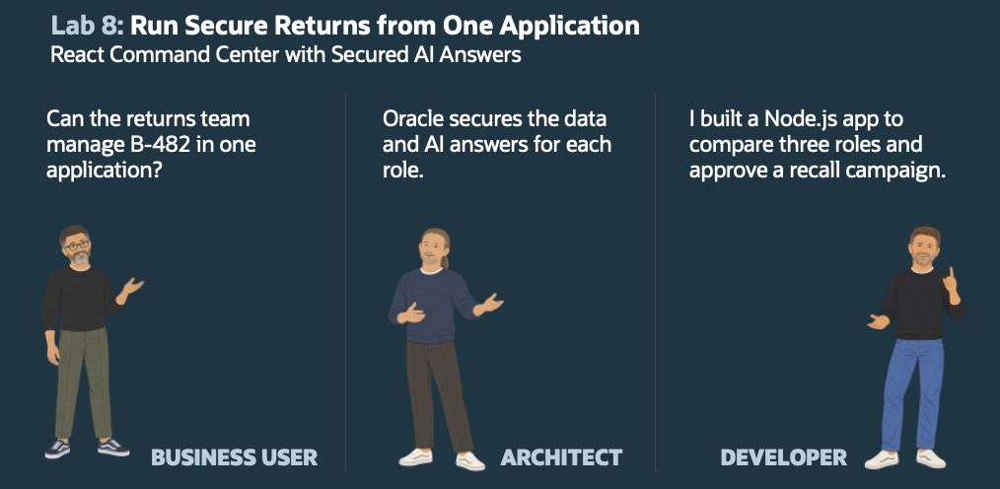
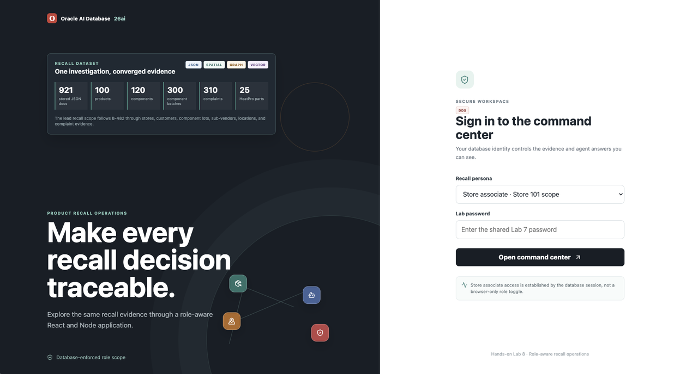
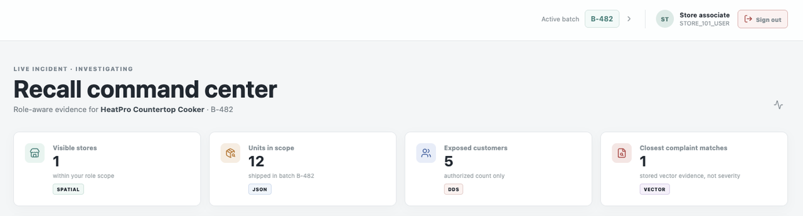
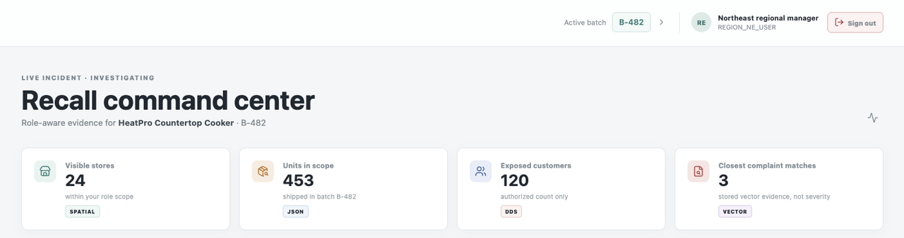
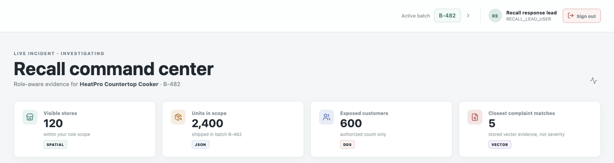

# Lab 8: Run Secure Returns from One React Application

## Introduction

Kevin now sees the application he asked for: one place for the returns team to review the B-482 scope, ask questions, and decide what to do next. Business users do not need to understand JSON, Spatial indexes, graph paths, vectors, agent tools, or security grants.

David combines the earlier database components without weakening their limits. The signed-in database user drives Deep Data Security filtering. The application receives product JSON, similar complaints, location impact, and graph results already limited to that user. An owner-side bridge calls the assistant only after the authorized document is built.

This lab installs mostly the application integration logic, connecting the React app to that foundation through approved packages and bridges; it also adds an governed campaign workflow. To keep this lab focused on configuring and using the app, it runs the prepared SQL instead of explaining every implementation statement. [Download and inspect `prepare-react-app.sql`](https://c4u04.objectstorage.us-ashburn-1.oci.customer-oci.com/p/EcTjWk2IuZPZeNnD_fYMcgUhdNDIDA6rt9gaFj_WZMiL7VvxPBNMY60837hu5hga/n/c4u04/b/livelabsfiles/o/database/05-prepare-react-app.sql) if you want the details; reading the script is optional.

Tim then configures the application and explores how the three roles use it. The application requests product details, authorized stores, graph paths, similar complaints, and assistant answers through approved packages. Its campaign workspace also lets a recall lead authorize contact, draft a reusable notice, and prepare auditable refund intents. Kevin gets one returns workflow rather than eight disconnected demonstrations.

By the end of the lab, Kevin can compare the Store 101, Northeast, and recall-lead views in one application. Each person receives a different authorized answer to the same B-482 question, based on JSON, Vector Search, Spatial, SQL Property Graph, and Select AI Agent results. The recall lead can also authorize a campaign, review a generic notice template, and approve refund intents for downstream processing. The application sends no messages and transfers no money.



Estimated Time: 45 minutes
### Objectives

In this lab, you will:

- Prepare application integration for the React/Node application.
- Configure and run the application against your Autonomous Database.
- Sign in as all three Deep Data Security local users.
- Compare role-filtered counts, maps, product evidence, and complaints.
- Run free-text vector searches against the authorized complaint evidence.
- Explore the `RECALL_GRAPH` component and supplier trace plus DDS-filtered store and customer exposure paths in the Oracle Graph Visualization Library.
- Ask the Select AI Agent questions through the secured database session.
- Compare converged agent answers grounded in JSON, Vector, Spatial, and Graph evidence.
## Task 1: Prepare the Database Connection for the Application

Kevin needs the application to call approved packages, not internal tables. David separates user-session retrieval from the owner-side assistant call; Tim prepares the application integration.

1. As `RECALL_OWNER`, download and install the Lab 8 setup script. **Run Script** executes this PL/SQL block; the installer rejects an older hosted file before it creates any Lab 8 objects.

    ```sql
    <copy>

    declare
        l_script clob;
    begin
        l_script := to_clob(dbms_cloud.get_object(
            credential_name => null,
            object_uri => 'https://c4u04.objectstorage.us-ashburn-1.oci.customer-oci.com/p/EcTjWk2IuZPZeNnD_fYMcgUhdNDIDA6rt9gaFj_WZMiL7VvxPBNMY60837hu5hga/n/c4u04/b/livelabsfiles/o/database/05-prepare-react-app.sql'
        ));
        dbms_cloud_repo.install_sql(
            content      => l_script,
            stop_on_error => true
        );
    end;
    /
    </copy>
    ```

    The script creates the application integration and the governed response campaign in one install. 

## Task 2: Download the Application Package

  Download the packaged React application and extract it on your workstation. 
  
  **macOS/Linux:**
  
  ```bash
  <copy>
  wget -O react-app-package.zip 'https://c4u04.objectstorage.us-ashburn-1.oci.customer-oci.com/p/EcTjWk2IuZPZeNnD_fYMcgUhdNDIDA6rt9gaFj_WZMiL7VvxPBNMY60837hu5hga/n/c4u04/b/livelabsfiles/o/database/react-app-package.zip'
  unzip react-app-package.zip
  </copy>
  ```
  
  **Windows (PowerShell):**
  
  ```powershell
  <copy>
  Invoke-WebRequest -Uri 'https://c4u04.objectstorage.us-ashburn-1.oci.customer-oci.com/p/EcTjWk2IuZPZeNnD_fYMcgUhdNDIDA6rt9gaFj_WZMiL7VvxPBNMY60837hu5hga/n/c4u04/b/livelabsfiles/o/database/react-app-package.zip' -OutFile react-app-package.zip
  Expand-Archive react-app-package.zip -DestinationPath .
  </copy>
  ```
  
  The command creates a `react-app` folder containing the application files. Continue to Task 3 to install the dependencies and configure your database connection.

## Task 3: Configure the Application

Kevin needs a usable returns application. David keeps connection details outside the code; Tim configures the runtime.

Use Node.js 20 or later. If `node --version` reports an older release, install a supported Node.js version before continuing. If you do not have Node.js installed, please check the  **Prerequisites: Install node** lab. 

1. In the same terminal, enter the extracted application folder, install the dependencies, and create your local environment file.

    ```bash
    <copy>
    node --version
    cd react-app
    npm ci
    cp .env.example .env
    </copy>
    ```

    **Windows (PowerShell):**

    ```powershell
    <copy>
    cd react-app
    npm ci
    Copy-Item .env.example .env
    </copy>
    ```

2. Use the SQL Developer Web URL in the **View Login Info** panel to derive the database TLS connect string. The URL has this form:

    `https://<DATABASE-ID>.adb.<REGION>.oraclecloudapps.com/ords/sql-developer`

    Take the database ID from the part before `.adb.`. In the service name, replace the dash (`-`) that separates the ID prefix and database name with an underscore (`_`). Take the region from the part after `.adb.` and before `.oraclecloudapps.com`; keep the region's hyphens unchanged.

    For example, from `https://G48D25C36182A4C-ATP240882.adb.eu-amsterdam-1.oraclecloudapps.com/ords/sql-developer`, use database ID `G48D25C36182A4C-ATP240882`, service-name ID `G48D25C36182A4C_ATP240882`, and region `eu-amsterdam-1`.

    Replace `<REGION>` and `<DATABASE_ID_WITH_UNDERSCORE>` in this TLS connect descriptor. The database host is `adb.<REGION>.oraclecloud.com`; the SQL Developer Web hostname is only for browser access. Do not add quotes around the replacement values.

    ```text
    <copy>
    (description= (retry_count=20)(retry_delay=3)(address=(protocol=tcps)(port=1522)(host=adb.<REGION>.oraclecloud.com))(connect_data=(service_name=<DATABASE_ID_WITH_UNDERSCORE>_medium.adb.oraclecloud.com))(security=(ssl_server_dn_match=yes)))
    </copy>
    ```

3. Edit `.env` and set the Autonomous Database connect string. Do not put a database password in `.env`; the password is entered into the sign-in form.

    ```text
    <copy>
      # Paste the complete TLS connect descriptor you built in Task 3, Step 2.
      ORACLE_CONNECT_STRING=<paste-the-complete-TLS-connect-string-here>
      COOKIE_SECURE=false
    </copy>
    ```

## Task 4: Run the React Application

Kevin needs a working command center that turns approved evidence into clear next actions. David defines that experience; Tim deploys the new application.

Start the packaged application. It serves the React interface and Node API from the same port.

1. In the `react-app` folder, start the application.

    ```bash
    <copy>
    npm start
    </copy>
    ```

    Open [http://localhost:3001](http://localhost:3001). The Node server serves the packaged production interface and the API routes from this origin.

    


## Task 5: Compare the Three User Views

Kevin checks whether the same application respects each job. David has designed the applicable identities. Tim compares the three results.

1. Sign in as 'store associate' (`STORE_101_USER`). Use the password from the 'View Login Info' panel.

    Confirm the header shows the store associate role. The expected result is:

    | Evidence | Store user |
    |---|---:|
    | Visible stores | 1 |
    | Units | 12 |
    | Customers | 5 |
    | Stored HEAT_ODOR matches | `9001` |

    The map shows only the authorized Store 101 location. The complaint list shows only complaint `9001`.

    
    

    The property graph shows the shared batch-to-component-batch-to-supplier-site trace and the downstream store/customer paths authorized for the signed-in user. Store 101 users see one store and five customer vertices; the Northeast user sees 24 stores and 120 customers; the recall lead sees 120 stores and 600 customers. The customer vertices contain only the authorized customer's name and identifier; email addresses are not returned.
    
    Use the graph **Distance** selector to control how much of the raw `RECALL_GRAPH` is visible at once. It starts at one hop from `B-482` and supports one through five hops. Use the **Filter** selector to show all vertices or focus on Components, Sub-components, Suppliers, Supplier sites, Stores, or Customers. Each page retains the shortest path back to `B-482`, including connecting stores and ancestors even when they fall on different pages. Search and hop distances use the full authorized graph. **Center graph** changes the viewport only; use **Reset filters** to clear the exploration.
    
    The agent receives a compact form of the same graph evidence: the batch-to-component-to-supplier path pattern, shared component and supplier counts, and the active role's authorized store/customer relationship counts. This keeps graph reasoning useful without sending the entire visualization payload to the model.
    
    In **Vector evidence**, the initial rows are ranked with the stored `HEAT_ODOR` query vector. Enter a phrase such as `burning smell and early shutoff` to run a new local-model embedding search. The embedding is generated by the owner-side model bridge, but complaint rows are ranked in the active end-user session, so DDS still limits the results. The order can vary with the stored query/model; semantic similarity is not severity or operational response priority. Use the complaint details and other authorized evidence to decide what needs attention.
    
2. Sign out and sign in as `REGION_NE_USER`.

    Confirm the header changes to Northeast regional manager. The expected result is:

    | Evidence                 | Northeast user         |
    | --------------------------| -----------------------:|
    | Visible stores           | 24                     |
    | Units                    | 453                    |
    | Customers                | 120                    |
    | Stored HEAT_ODOR matches | `9001`, `9002`, `9006` |
    
    The map and graph show the authorized Northeast footprint. Complaint `9003` remains hidden because its customer is outside the regional grant. The graph likewise excludes stores and customers outside the active DDS role.

    

3. Sign out and sign in as `RECALL_LEAD_USER`.

    Confirm the header changes to recall response lead. The expected result is:

    | Evidence | Recall lead |
    |---|---:|
    | Visible stores | 120 |
    | Units | 2,400 |
    | Customers | 600 |
    | Stored HEAT_ODOR matches | `9001`, `9002`, `9006`, `9003`, `9007` |

    The map and graph show the full authorized continental U.S. footprint. Shared component and supplier-site facts remain available to every persona because they describe recall evidence, while downstream store and customer vertices are still produced from the active DDS-filtered session. The agent receives the same distinction: shared component/supplier trace plus role-specific spatial and exposure evidence.    

    
    

4. Compare the experience with the database session, not the browser selection. The Node API reads the active end-user identity from `ORA_END_USER_CONTEXT` after login. The same application code and same SQL package calls produce different results because the database applies different data grants.

## Task 6: Ask the Assistant

Kevin asks the final business question. 

1. While signed in as each persona, ask a question from the chat panel:

    - `What is the authorized recall scope for B-482?`
    - `Which complaint evidence should I review first?`
    - `What action should this team take next?`

2. Confirm that each answer stays inside the active persona scope. The agent can summarize only the four sections assembled by `RECALL_REACT_API`: product JSON, authorized vector/relational data, authorized Spatial impact, and Graph data. It cannot query tables, retrieve hidden complaints, or expand a store user into company totals.

3. Ask converged questions that require more than one feature:

    - `Which response regions and centers should this role prioritize, and why?`
    - `Which component lots and supplier sites are connected to this recall?`
    - `Which complaint evidence supports the spatial and graph pattern visible to me?`

    The answer should combine only the sections relevant to the question. A store user receives Store 101 spatial and exposure evidence; a regional manager receives the Northeast footprint; the recall lead receives the full authorized footprint.

## Task 7: Explore the Governed Recall Campaign

    Kevin needs the team to prepare a customer response without letting an AI model decide who qualifies or sending a message before a person reviews it. The campaign workspace uses the same database identity and application session as the rest of the command center, then adds explicit contact authorization, a reusable draft, a human approval, and an audit trail.
    
    1. Sign in as `RECALL_LEAD_USER` and open **Recall Campaign**. Review the policy state before acting. Contact is disabled until the recall lead authorizes it.
    2. Select **Authorize customer contact**. The authorized workspace creates a generic notice draft using the default `EMAIL` channel and `PROFESSIONAL` tone. Change the channel or tone and select **Regenerate generic draft** to explore the options.
    3. Review the generic template. It contains campaign facts and placeholders, not customer names or email addresses. The campaign package obtains eligible purchases in the active Deep Data Security session; customer details are merged only after the agent returns the generic template.
    4. Select one authorized customer order and choose **Generate for selected customer**. Review the personalized preview, deterministic refund amount, and approved refund steps. Selecting a customer creates a draft record for that one authorized purchase; it does not send a notice.
    5. Select **Approve campaign and create refund intents** after reviewing the personalized notice. The database records the lead's approval, updates the campaign and selected recipient statuses, and creates one `READY_FOR_PROCESSING` refund intent for each purchase personalized in that campaign. Approval does not apply to the full eligible audience. This prepares records for a later payment integration; it does not transfer funds.
    6. Sign out and repeat the campaign view as `REGION_NE_USER` and `STORE_101_USER`. Compare the eligible audience with the recall lead's. Each audience follows the active database identity and its Lab 7 data grant.
    
    As `RECALL_OWNER`, inspect the audit trail and refund intents after approval:

    ```sql
    select campaign_id, batch_id, status, recipient_count, total_refund,
           template_source, approved_by
    from   recall_campaigns
    order  by campaign_id desc;

    select campaign_id, purchase_id, refund_amount, status
    from   recall_refund_intents
    order  by refund_intent_id desc;

    select action_name, actor_name, detail_text, created_at
    from   recall_campaign_audit
    order  by audit_id desc
    fetch first 10 rows only;
    ```

    The campaign boundary is: database policy and Deep Data Security determine the audience; Select AI Agent drafts generic language; the application merges authorized customer facts; the recall lead reviews and approves; database packages record the decision and create refund intents. The workshop does not send customer messages or move money.
    
    You have completed the workshop. The React and Node application brings together database-enforced access, live evidence and agent answers, and a human-governed response workflow in one place.

## Conclusion

    Kevin's requirements now appear in one returns application. Each signed-in user can see the B-482 records that apply to their role, view the related locations and suppliers, ask the assistant a question without receiving broader access, and prepare only the response actions their role permits.
    
    David keeps the application rules in Oracle AI Database: packages provide the data, Deep Data Security applies the user scope, and the owner-side bridge calls the assistant only after that filtering. The application does not need to duplicate those rules or combine results from separate JSON, vector, Spatial, or graph databases. Tim brings the results together in React.

## Appendix: Install Node.js
#### Install Node.js and npm

Use the package manager for your operating system. These commands install Node.js and npm; you do not need to install Oracle Instant Client for this application.

- **macOS:** In Terminal, install [Homebrew](https://brew.sh/) if it is not already installed, then run:

    ```bash
    <copy>
    brew install node
    node --version
    npm --version
    </copy>
    ```

- **Windows:** Open PowerShell or Windows Terminal and install the Node.js LTS package with [Windows Package Manager](https://learn.microsoft.com/windows/package-manager/winget/):

    ```powershell
    <copy>
    winget install --id OpenJS.NodeJS.LTS --exact
    </copy>
    ```

    Close and reopen the terminal, then verify the installation:

    ```powershell
    <copy>
    node --version
    npm --version
    </copy>
    ```

Both checks should print version numbers. Confirm that Node.js is version 20 or later before continuing.

## Learn More

- [Oracle Deep Data Security Guide](https://docs.oracle.com/en/database/oracle/oracle-database/26/ddscg/)
- [node-oracledb documentation](https://node-oracledb.readthedocs.io/en/latest/)
- [React documentation](https://react.dev/)
- [Leaflet documentation](https://leafletjs.com/)

## Acknowledgements

- **Author:** Tim Cline, Product Management Architect
- **Contributors**: David Start, Director and Kevin Lazarz, Senior Manager
- **Last updated:** October 2026
