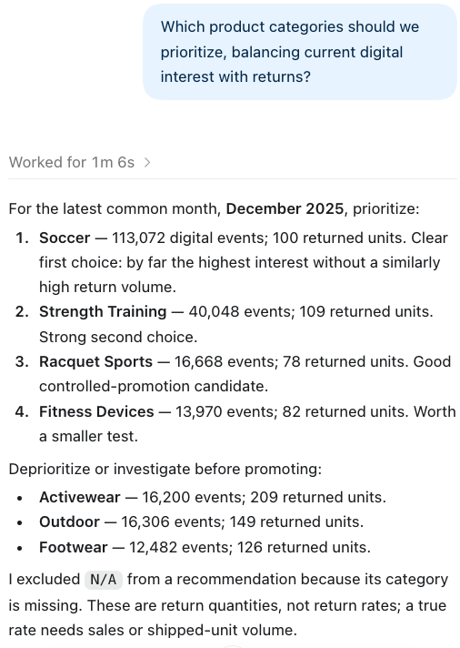

# Lab 5: Create an Analytic View with Codex

Estimated Time: 20 minutes

## Introduction

Lab 4 improved the product-interest answer by adding reviewed meaning to the source tables. Now PeakGear asks a harder question:

**Which product categories should we prioritize, balancing current customer interest with returns?**

The interest and return measures come from separate snapshots, so a one-off join does not provide the shared, reviewable model this comparison needs.

In this lab, you first identify the model requirements. Then you ask Codex through LiveLab MCP to create or reuse and validate **one Analytic View** with product-to-category and month hierarchies

The model defines digital event count and returned units as two additive measures for the same completed month.

After validation, ask the question again and review the governed category answer with product-level drill-down.

Codex sends explicit SQL DDL through **adp\_run\_query**, not **adp\_build\_analytic\_view**, and checks the model against the saved Data Studio definitions. You do not paste the DDL.

### Objectives

In this lab, you will:

* Ask the harder business question and identify the governed-model gap;
* Ask Codex to build the governed model through MCP;
* Confirm that one AV and both measures are validated and reconciled; and
* Receive a governed category recommendation with drill-down evidence.

### Prerequisites

Complete Lab 4, including the saved descriptions and tags for LAB\_DIGITAL\_INTENT\_RAW\_T, LAB\_PRODUCTS\_RAW\_T, and LAB\_RETURNS\_RAW\_T. Keep the same Codex task and LiveLab MCP connection open. This lab does not repeat AI Enrichment or create an AI profile.

## Task 1: Ask the harder business question

In Codex, ask:

~~~text
<copy>
Which product categories should we prioritize, balancing current customer
interest with returns?
</copy>
~~~

## Task 2: Review the governed-model requirements

Expected result: Codex should state that it needs a governed model before making the recommendation. It should identify all of these requirements:

* One common, completed-month time window;
* A reusable category-to-product hierarchy;
* Digital events with non-NULL product IDs aggregated by product and month, with unattributed events counted and reported separately;
* Returned units aggregated independently by product and month before the two measures are combined; and
* Governed drill-down rather than a one-off cross-source join.

This controlled stop is the point: Codex identifies the reusable model the recommendation needs before it analyzes the sources.

<!-- Screenshot to insert after approved dry run: images/governed-model-gap.png
     Alt text: Codex identifies the time, hierarchy, and aggregation rules
     required before returning a cross-source recommendation. -->

### Checkpoint

Codex has reused the Data Studio metadata saved in Lab 4 and identified the governed-model requirements without inventing a recommendation. Continue to Task 3 in this same lab to build the model.

## Task 3: Ask Codex to build the model

1. **Submit the build request** in the same Codex task you have used since Lab 3.

    - Click **Copy** in the upper-right corner of the block below, then paste it into Codex.

    - The Lab 3 boundary already applies. Do not paste it again.

    - Codex checks for suitable existing objects and chooses any needed names from the saved source definitions. Do not prescribe names from another run.

                    <copy>
               Go ahead: create or reuse and validate one Analytic View to answer:
               Which product categories should we prioritize, balancing current customer interest with returns?

               Follow the established boundary. Use existing local tables and reviewed metadata.

               Reuse suitable dependencies and create only what is missing in PEAKGEAR_USER.
               Avoid repeated discovery and unnecessary rebuilds, but keep the required validation.

               Return a short summary of the AV and validation results.
                    </copy>

**Expected result:** Codex should:

* Batch independent metadata reads and validate product keys and category mappings;
* Reuse a suitable existing AV and its dependencies, or create only the supporting local tables, dimensions, hierarchies, and one AV that are missing, using explicit SQL DDL through adp\_run\_query;
* Run one consolidated health check and reconcile both measures for the latest shared completed month against the local sources; and
* Stop and report if an essential metric definition is missing, a product mapping is ambiguous, or a required permission prevents completion.

**Keep the build within this scope:**

* The PEAKGEAR\_USER boundary from Lab 3 still applies. Use the object names Codex reports; you do not need to prescribe them.
* Do not use the high-level auto-builder or create exploratory AVs or a second AV for returns. Reuse verified metadata and dependencies.
* Codex runs SQL through MCP; you do not paste DDL.
* After a timeout or ambiguous error, check whether the affected object exists and whether the operation completed before retrying. Repeat checks only after a failure or relevant change.
* A missing unknown-category annotation alone is not a blocker. The Lab 3 boundary provides an explicit default, which Codex applies and briefly reports.

**Before the build, validate attribution against the shared catalog:**

* Exclude digital events with NULL PRODUCT\_ID from product and category rankings, and report their count for the same common month. Keep the raw source table intact.
* Each non-NULL product ID in either fact must map to exactly one catalog product. Stop and report missing products or ambiguous product-key mappings; do not drop records or invent mappings.
* For products with NULL or blank categories, use the saved rule or the Lab 3 default. Retain their measures in an `Unknown / Unspecified` technical bucket in the derived model, include the bucket in reconciliation, and report its totals separately from named-category recommendations. The absence of a saved unknown-category rule does not block the AV build.
* Preserve source labels such as `N/A` and the literal text `null`. Report them separately from named-category recommendations. Do not assign categories from product names.

**For the comparison and reconciliation:**

* Aggregate each fact independently by product and month before combining it. Preserve product-month rows present in either source.
* Query category rows for the common month for the final comparison. Use product detail for drill-down.
* Do not sum detail rows together with their All-level totals. The model does not require a store hierarchy.

**Snapshot boundary:** The Lab 2 raw tables and any supporting aggregate tables are workshop snapshots. Codex must state their source month and validate the model against those tables. Do not imply continuous refresh unless the model implements it.

<!-- Screenshot to insert after approved dry run: images/codex-builds-av.png
     Alt text: Codex uses explicit SQL through LiveLab MCP to create or reuse
     and validate one PeakGear Analytic View with both measures. -->

## Task 4: Ask the final business question

After the validation succeeds, ask the same business question in the Codex task:

~~~text
<copy>
Which product categories should we prioritize, balancing current customer
interest with returns?
</copy>
~~~

**Expected result:** Codex answers from the validated Analytic View and gives a governed drill-down to relevant categories and products. It states the completed-month window and these measures:

* Customer interest = digital event count for non-NULL product IDs;
* Digital events without product IDs are excluded from category ranking and their count is reported separately for the common month;
* Returns = sum of returned units; and
* Returns are quality context, not a return rate.

### Checkpoint

The Analytic View created or reused by Codex is valid and queryable, both measures reconcile for the shared completed month, and Codex can answer the final question through its governed hierarchies and measures.

## Summary

The same customer-interest concept progressed through three stages:

| Stage | What Codex can do | Why |
|---|---|---|
| Raw sources | Refuse to invent the answer | Fields do not define the business question. |
| Data Studio annotation | Answer a clearly defined event ranking with product labels | The metric, grain, time window, and product lookup are saved. |
| One validated Analytic View | Make a governed cross-source recommendation with drill-down | Both measures share reviewed time, hierarchy, and aggregation semantics. |

## Learn More

* [Oracle Data Studio Guide](https://docs.oracle.com/en/cloud/paas/autonomous-database/data-studio-guide/)

## Acknowledgements

* **Author** - Oracle AI Lakehouse workshop team
* **Last Updated By/Date** - Oracle AI Lakehouse workshop team, October 2026
