# Lab 1: Sign in as PEAKGEAR\_USER

Estimated Time: 5 minutes

## Introduction

PeakGear is a fictional sporting goods retailer. Its product catalog and digital interactions are in Databricks; operational return events are in an Oracle database.

The question guiding this workshop is:

**Which product categories should we prioritize, balancing current customer interest with returns?**

Connecting the sources is only the start. Later labs define what customer interest means and build a governed model before Codex makes a recommendation.

Your LiveLabs reservation already includes the database, participant account, Operations connection, and AI profile. In this first lab, find your reservation values, connect Data Studio to the assigned database as PEAKGEAR\_USER, and verify the session. That gives the source-connection work in Lab 2 a reliable starting point. OCI sign-in and database sign-in use different credentials, so use the values from your own active reservation, not the screenshot examples.

### Objectives

In this lab, you will:

* Find your assigned environment and credentials in LiveLabs; and
* Connect **Data Studio** to your prepared database as PEAKGEAR\_USER.

### Prerequisites

* An active LiveLabs reservation with a ready environment.
* Codex installed and signed in before starting **Lab 3**, with an account that can create a local task. Arrange installation and account access with the event organizer before the workshop.
* A **macOS** laptop with **Terminal** or a **Windows** laptop with **Windows PowerShell**.**Lab 3** provides a separate setup path for each operating system.

**_Important notice:_**

- The data and credentials shown in the following screenshots are **for illustration purposes only**. The database password has been redacted.
- Always copy the values from your own reservation when completing these steps.

## Task 1: Find your reservation details

1. Open **Reservation Information** in LiveLabs and check **Reservation Time Remaining**.

    - Allow at least **75 minutes** to complete the workshop. Extend the reservation while it is active if you need more time.

    - An **EXPIRED** reservation cannot be restored by restarting MCP. Start a new reservation and use its new connection values.

    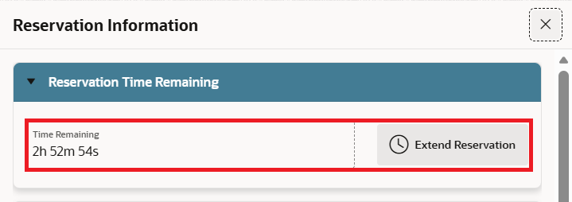

2. Sign in to OCI.

    - Expand **Login Credentials** and copy **Username** and **Password**.

    - On first sign-in, OCI may ask you to set a new password. If the **Reset your password** screen appears, complete the reset and use the new password for later OCI sign-ins.

    - Resetting the OCI password does not change the separate **Database Password** in Environment Details.

    - Use **Database Password** for Data Studio. **Launch OCI** opens the OCI Console.

    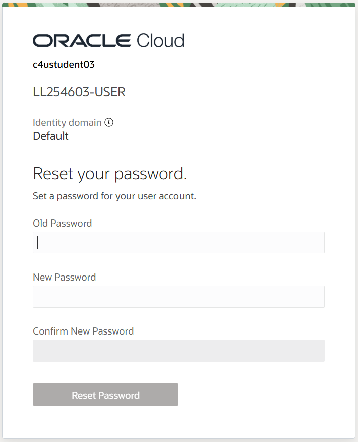

3. Record the tenancy details.

    - In **Tenancy Information**, note **Tenancy Name**, **Region**, and **Compartment**.

    - Use **Region** to find your database. Do not use **Generative AI Endpoint Region**.

    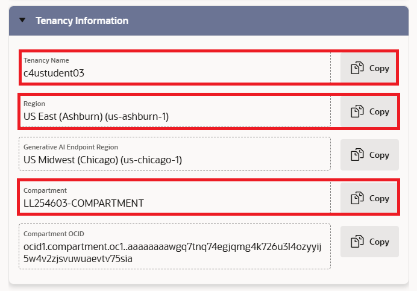

4. Copy your database details from **Environment Details**.

    - Copy **Database Name**, **Database User**, and **Database Password** for the Data Studio connection.

    - Keep **AI Profile Name** and **Operations Database Link** handy for later labs.

    - Lab 2 uses DBX\_PEAKGEAR\_OAUTH and ADLS\_PEAKGEAR\_DATA, which provisioning already created. You do not need their passwords or OAuth values.

    - Leave Reservation Information open while you work.

    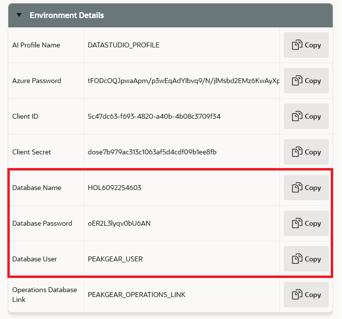

The current workshop expects Database User **PEAKGEAR\_USER** and Operations Database Link **PEAKGEAR\_OPERATIONS\_LINK**. If your reservation shows different values, ask the instructor before continuing; do not use values from the screenshots.

## Task 2: Connect Data Studio to the assigned database

1. Open **[Oracle Data Studio](https://datastudio.oracle.com).**

2. Sign in to the reserved tenancy.

    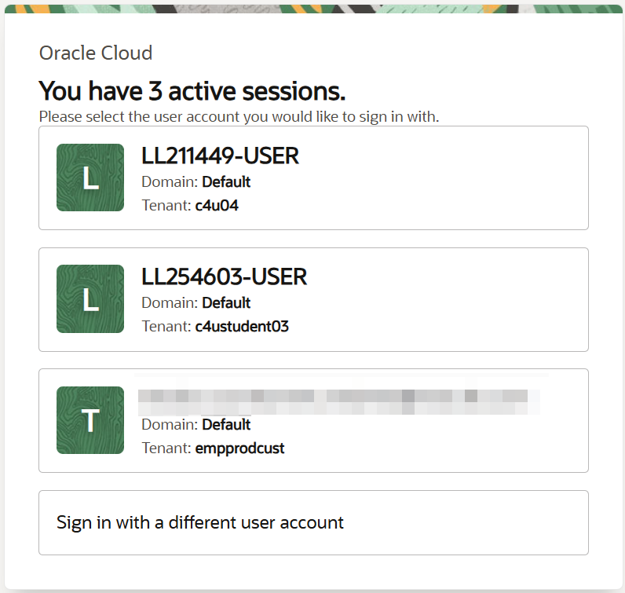

    - Use the **OCI Login Credentials** and **Tenancy Name** from your reservation.

    - If Data Studio opens another tenancy, switch to the reserved one.

3. Find your database.

    - Select the **Region** and **Compartment** from **Tenancy Information**.

    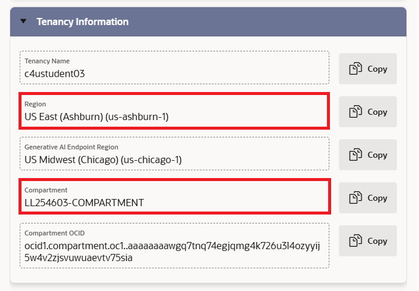
    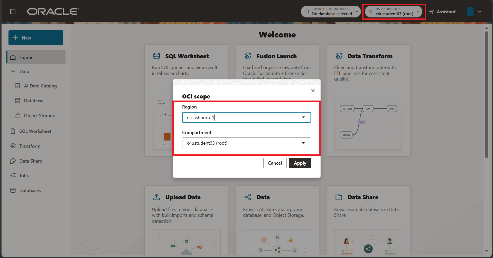

    - Open **Databases** and select the **Database Name** from Environment Details.

    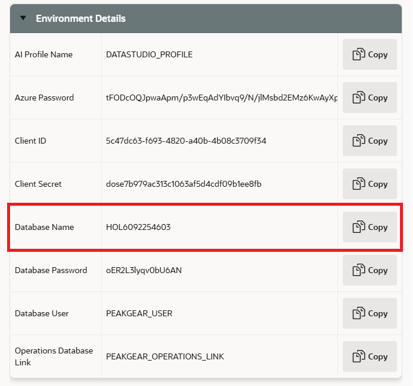

4. Open the database's **Actions** menu and choose **Connect**.

    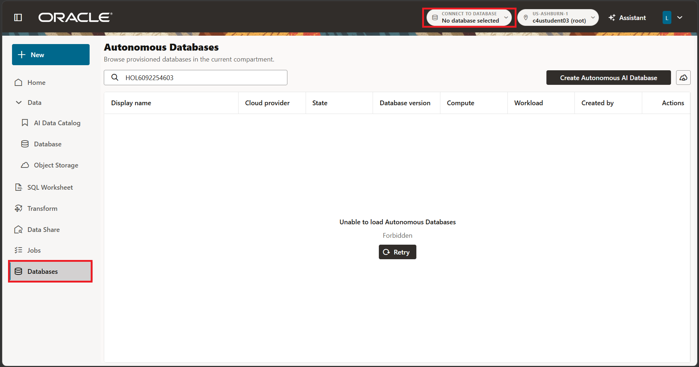
    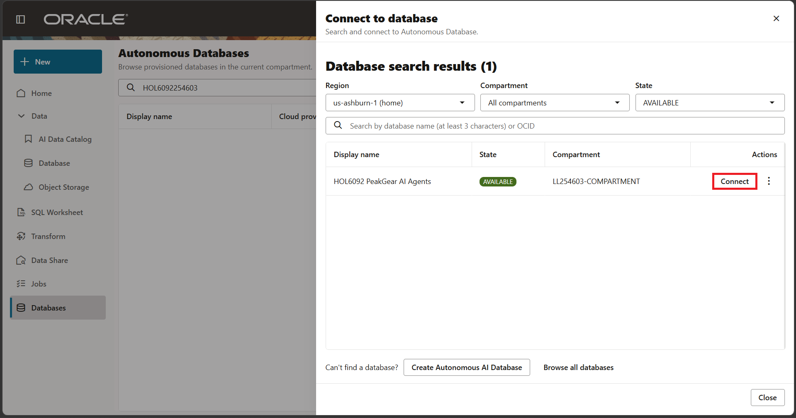

5. Connect as the participant user.

    - Enter **Database User** and **Database Password** from Environment Details, then click **Connect**.
    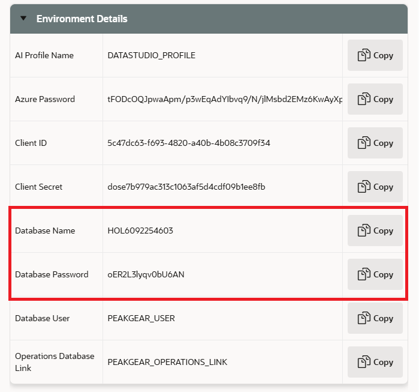
    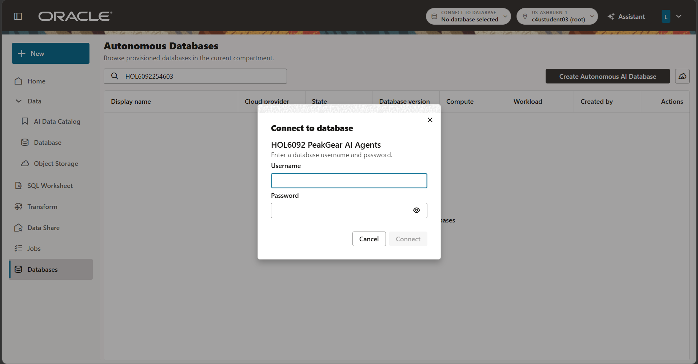

    - Do not use the OCI password here.

6. Verify the database session. In **SQL Worksheet**, run:

    ~~~sql
    <copy>
    SELECT USER AS database\_user,
           SYS\_CONTEXT('USERENV', 'CURRENT\_SCHEMA') AS current\_schema
    FROM dual;
    </copy>
    ~~~

    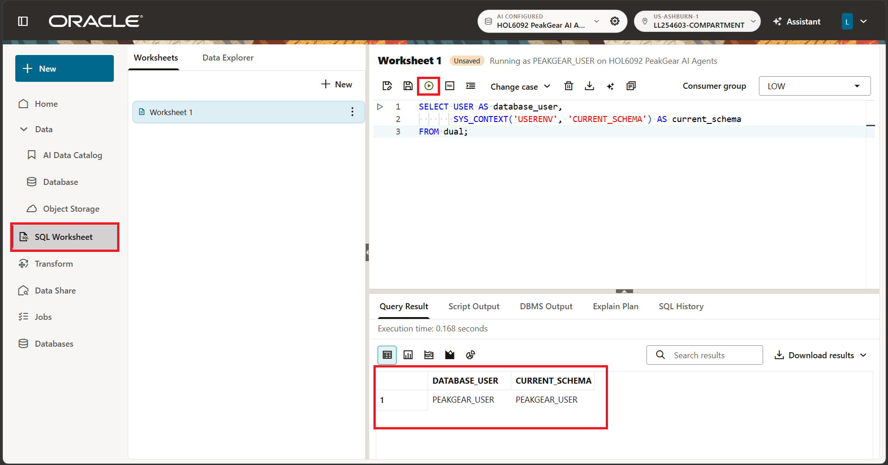

    - Both values must be PEAKGEAR\_USER.

    - Check that the database name in the header matches your reservation.

7. Confirm the AI profile is available.

    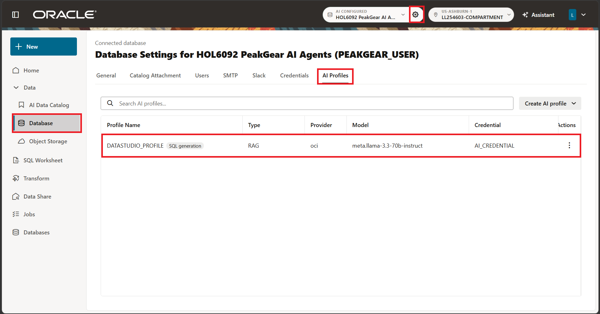

    - The profile is already provisioned. If needed, open **Database Settings → AI Profiles** and check the **AI Profile Name** from your reservation. An example reservation uses PEAKGEAR\_LAB\_PROFILE.

    - Do not create or edit a profile or select **Create all user permissions**.

    - If the profile is missing or AI Enrichment is unavailable, ask the instructor to repair the reservation. **SETUP NEEDED** can refer to optional OCI workflows; it does not mean that you should repeat provisioning.

### Checkpoint

Your connected database matches the reservation and the session is PEAKGEAR\_USER. Keep Reservation Information open for your database password and profile name.

## Learn More

* [Access and navigate Oracle Data Studio](https://docs.oracle.com/en/cloud/paas/autonomous-database/data-studio-guide/access-and-navigate.html)
* [Work with database connections and resources](https://docs.oracle.com/en/cloud/paas/autonomous-database/data-studio-guide/work-database-connections-and-resources.html)

## Acknowledgements

* **Author** - Oracle AI Lakehouse Workshop Team
* **Last Updated By/Date** - Oracle AI Lakehouse workshop team, November 2026
