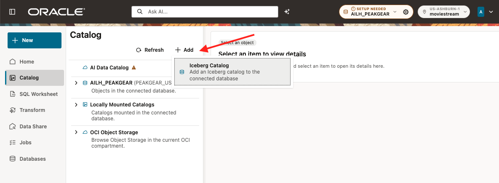
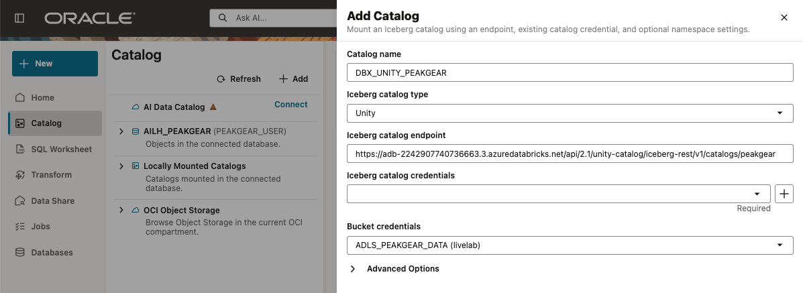
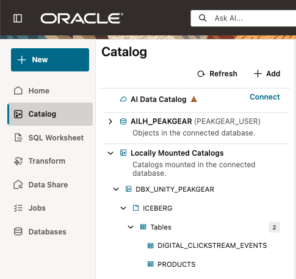

# Lab 2: Connect real sources

Estimated Time: 15 minutes

## Introduction

PeakGear wants to know which product categories to prioritize after comparing customer interest with returns. The data for that question is split across Databricks Unity Catalog, which holds the product catalog and clickstream events, and an Oracle Operations database, which holds return events.

In this lab, you verify access to the live sources, connect the Databricks catalog, and create local snapshots for later enrichment and analysis. The tables give the next labs a consistent starting point, but do not refresh automatically.

### Objectives

In this lab, you will:

* Identify the two provisioned source credentials;
* Connect the Databricks Unity Iceberg catalog using those credentials;
* Prove access to the two connected sources; and
* Create the three raw business objects used by Codex.

## Task 1: Verify the provisioned source credentials

LiveLabs provisioning has already created both credentials for PEAKGEAR\_USER in your assigned database:

| Credential | Purpose |
|---|---|
| ADLS\_PEAKGEAR\_DATA | Read the Iceberg files in Azure Blob Storage |
| DBX\_PEAKGEAR\_OAUTH | Authenticate to Databricks Unity Catalog |

1. Open the credential list. In Data Studio, open the connected database's **Settings** (gear icon), then select **Credentials**.

2. Confirm both credentials appear.

    - You will select them in Task 2. Do not create credentials or enter storage passwords, client IDs, or client secrets.

    - If a credential is missing, stop and ask the instructor to check the reservation. Provide the missing name and your **Database Name**.

    - See the [Connection field reference](../assets/event-lab-values.md) for the prepared names and public connection settings.

## Task 2: Connect the Databricks Unity Catalog

1. Open the catalog form. In **Catalog**, click **Add**, then choose **Iceberg catalog**.

2. Enter the public catalog settings from the table.

| Field | Value |
|---|---|
| Catalog name | DBX\_UNITY\_PEAKGEAR |
| Iceberg catalog type | Unity |
| Iceberg catalog endpoint | https://adb-2242907740736663.3.azuredatabricks.net/api/2.1/unity-catalog/iceberg-rest/v1/catalogs/peakgear |
| Iceberg catalog credentials | Select DBX\_PEAKGEAR\_OAUTH |
| Bucket credentials | Select ADLS\_PEAKGEAR\_DATA |

3. Select credentials and add the catalog.

    - Choose DBX\_PEAKGEAR\_OAUTH for **Iceberg catalog credentials**.

    - Choose ADLS\_PEAKGEAR\_DATA for **Bucket credentials**.

    - Click **Add**.

4. Confirm the catalog mounted.

    - Expand **Locally Mounted Catalogs > DBX\_UNITY\_PEAKGEAR > ICEBERG > Tables**.

    - Check for **PRODUCTS** and **DIGITAL\_CLICKSTREAM\_EVENTS**.

    - Use **Refresh** only if the catalog or tables are not visible yet.

### SQL reference (not part of the lab)

> **For reference only:** The same Databricks Unity connection can also be configured in **SQL Worksheet**. This is not a required lab step; the UI workflow above remains the main path. If the catalog is already connected, skip this reference.

For this optional path:

1. Open SQL Worksheet in your assigned database as PEAKGEAR\_USER. The [SQL reference](../scripts/02-unity-sql-reference.sql) reuses Task 1's credentials; no values or placeholders are needed.

2. Run the block below and wait for the worksheet's completion message.

    - It checks the participant identity and both provisioned credentials.

    - It mounts the catalog only if it does not already exist.

    - It does not create, replace, refresh, or delete credentials.

~~~sql
<copy>
-- SQL reference only; not part of the required Lab 2 workflow.
-- Run as PEAKGEAR_USER with both source credentials already provisioned.
-- This block reuses credentials and mounts only when the catalog is absent.
DECLARE
  l_credential_count PLS_INTEGER;
  l_catalog_count PLS_INTEGER;
BEGIN
  IF USER <> 'PEAKGEAR_USER'
     OR SYS_CONTEXT('USERENV', 'CURRENT_SCHEMA') <> 'PEAKGEAR_USER' THEN
    RAISE_APPLICATION_ERROR(-20011,
      'Use SQL Worksheet connected as PEAKGEAR_USER in your assigned database.');
  END IF;

  SELECT COUNT(*) INTO l_credential_count
  FROM user_credentials
  WHERE credential_name IN ('ADLS_PEAKGEAR_DATA', 'DBX_PEAKGEAR_OAUTH');

  IF l_credential_count <> 2 THEN
    RAISE_APPLICATION_ERROR(-20014,
      'Provisioned source credentials are missing. Ask the instructor to repair this reservation.');
  END IF;

  SELECT COUNT(*) INTO l_catalog_count
  FROM user_mounted_catalogs
  WHERE catalog_name = 'DBX_UNITY_PEAKGEAR';

  IF l_catalog_count = 0 THEN
    DBMS_CATALOG.MOUNT_ICEBERG(
      catalog_name            => 'DBX_UNITY_PEAKGEAR',
      endpoint                =>
        'https://adb-2242907740736663.3.azuredatabricks.net/api/2.1/' ||
        'unity-catalog/iceberg-rest/v1/catalogs/peakgear',
      catalog_credential      => 'DBX_PEAKGEAR_OAUTH',
      data_storage_credential => 'ADLS_PEAKGEAR_DATA',
      enabled                 => TRUE,
      catalog_type            => 'ICEBERG_UNITY'
    );
  ELSE
    DBMS_OUTPUT.PUT_LINE(
      'DBX_UNITY_PEAKGEAR already exists. Continue with the sample reads in Lab 2 Task 3.');
  END IF;
END;
/
</copy>
~~~

3. Confirm the catalog in Catalog.

    - Refresh **Locally Mounted Catalogs** if needed.

    - Confirm DBX\_UNITY\_PEAKGEAR contains **ICEBERG → Tables → PRODUCTS** and **DIGITAL\_CLICKSTREAM\_EVENTS**.

    - Continue to Task 3 after a successful mount or an already-existing-catalog message. Its sample queries confirm read access.

If a credential is missing or SQL reports an error, keep the exact message and ask the instructor. After a timeout, inspect **Catalog** before retrying; the mount may have completed. Do not drop or unmount objects to force a retry.

## Task 3: Prove the two live sources

1. Create the live-source worksheet. Open **SQL Worksheet** as PEAKGEAR\_USER and save it as **PeakGear - Live source checks**.

2. Run each query below separately. **Run SQL** executes the current statement, not every statement in a pasted script.

~~~sql
<copy>
SELECT *
FROM iceberg.products@dbx_unity_peakgear
FETCH FIRST 5 ROWS ONLY;
</copy>
~~~

~~~sql
<copy>
SELECT *
FROM iceberg.digital_clickstream_events@dbx_unity_peakgear
FETCH FIRST 5 ROWS ONLY;
</copy>
~~~

~~~sql
<copy>
SELECT *
FROM customer_return_events@peakgear_operations_link
FETCH FIRST 5 ROWS ONLY;
</copy>
~~~

3. Check the query results.

    - Each query should return up to five sample rows. This confirms read access without a full row count.

    - The prepared sources should contain data. If a query returns no rows or an error, ask the instructor to check the source before continuing.

    - Sample rows do not prove product-key uniqueness. MCP checks the local product table before analytics.

4. Create the snapshot worksheet. Save a second worksheet as **PeakGear - Local snapshots**.

5. Create the three participant-owned tables by running the blocks below in order, one at a time.

    - Wait for the worksheet to report completion before starting the next `CREATE TABLE AS SELECT`.

    - If a table already exists, verify it in Catalog instead of recreating it.

    - Do not replace a table after saving its annotations in Lab 4.

    - If an older run left `*_RAW_V` views in the schema, leave them alone. This version uses the new `*_RAW_T` tables and requires fresh annotations in Lab 4.

~~~sql
<copy>
CREATE TABLE lab_products_raw_t AS
SELECT product_id,
       product_name,
       category AS category_name
FROM iceberg.products@dbx_unity_peakgear;
</copy>
~~~

~~~sql
<copy>
CREATE TABLE lab_digital_intent_raw_t AS
SELECT product_id,
       session_id,
       customer_id,
       CAST(event_ts AS TIMESTAMP) AS event_ts
FROM iceberg.digital_clickstream_events@dbx_unity_peakgear;
</copy>
~~~

~~~sql
<copy>
CREATE TABLE lab_returns_raw_t AS
SELECT product_id,
       store_id,
       return_qty,
       CAST(return_created_at AS TIMESTAMP) AS return_created_at
FROM customer_return_events@peakgear_operations_link;
</copy>
~~~

6. Verify the local tables in Catalog.

    - Under PEAKGEAR\_USER, confirm that all three tables exist.

    - Open **Sample Data** for each table and confirm that rows are present.

    - These local snapshots do not refresh automatically and do not yet have business definitions.

    - Later labs use them through Data Studio and the bounded MCP server. If MCP reports duplicate product keys, ask the instructor to investigate; do not deduplicate arbitrarily or invent a mapping.

### Checkpoint

You can read both Iceberg tables and the Operations return table. The three raw lab tables exist under PEAKGEAR\_USER.

## Learn More

* [Oracle Data Studio Guide](https://docs.oracle.com/en/cloud/paas/autonomous-database/data-studio-guide/)

## Acknowledgements

* **Author** - Oracle AI Lakehouse workshop team
* **Last Updated By/Date** - Oracle AI Lakehouse workshop team, November 2026
