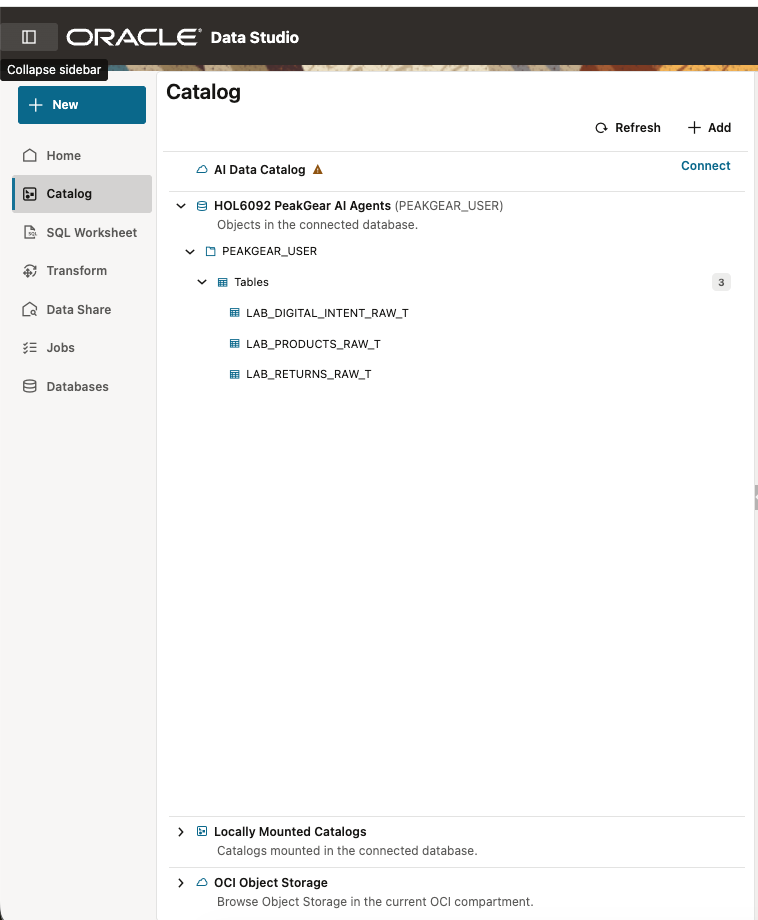
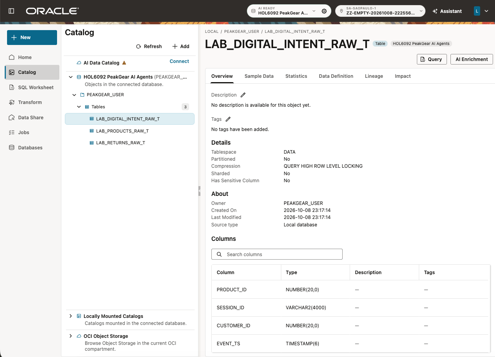
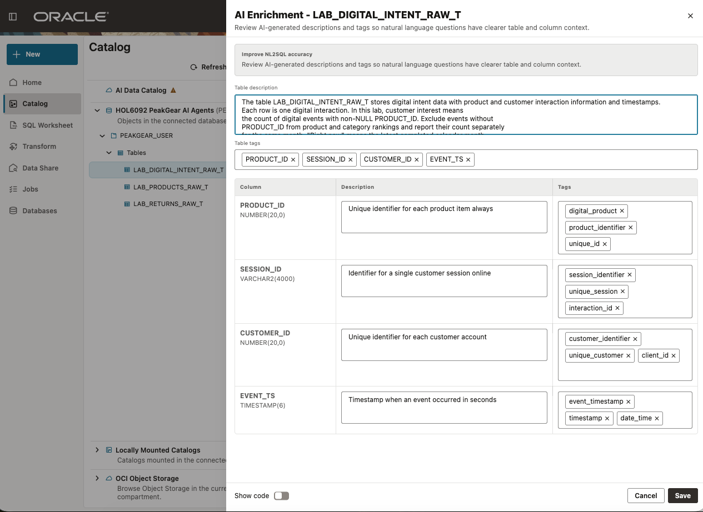
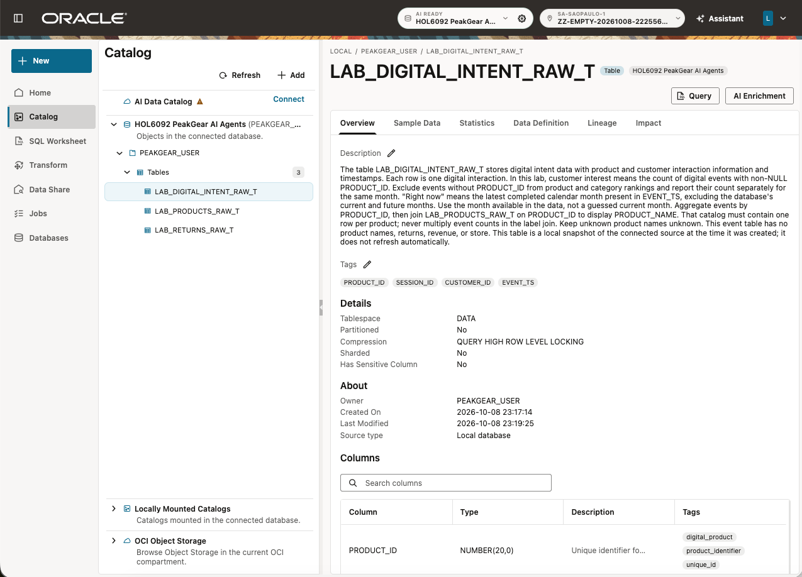

# Lab 4: Add business meaning with AI Enrichment

Estimated Time: **12 minutes**

## Introduction

Lab 3 ended with Codex stopping before it ranked products. The source columns did not define what customer interest means or which month “right now” refers to.

The question stays the same; this lab changes the context available to answer it.

Use **AI Enrichment** to review descriptions and tags for the local digital, product, and returns tables. Keep accurate suggestions and add the business rules the column names cannot express. 

After you save and verify the annotations, ask the Lab 3 question again. Codex should now use the reviewed event metric, time period, and product labels. Lab 5 reuses these annotations; it does not run AI Enrichment again.

### Objectives

In this lab, you will:

* Use Data Studio AI Enrichment without creating an AI profile;
* Review and save descriptions and tags for all three raw tables;
* Define digital interest, product labels, and returned units; and
* Ask exactly the same business question again.

## Task 1: Open AI Enrichment

Continue in the Codex task from Lab 3. Keep it open while you edit metadata in Data Studio. The default AI profile is already prepared.

1. Open Catalog in Data Studio, then open the PEAKGEAR\_USER schema and select **Tables**.

    - Confirm that the three local tables from Lab 2 appear.
    - The database shown in the screenshots is an example. Use your reservation's database.

    

2. Select LAB\_DIGITAL\_INTENT\_RAW\_T and open **Overview**.

    - On a fresh table, its description and tags are empty.
    - Overview also lists the table's columns.

3. Click AI Enrichment in the upper-right corner.
    

4. Wait for generation to finish and check the annotations.
    - The table and **every column** should have a description and tags.
    - AI-generated text is a suggestion. An editable dialog alone does not confirm that generation succeeded.

5. Confirm the dialog targets the selected table before saving.
    - Turn on **Show code** and check that **ALTER TABLE** names this table under PEAKGEAR\_USER.
    - If the target table or object type differs, cancel and ask the instructor.

If Data Studio reports **invalid column tags** or **did not return column tags**, keep the error and ask the instructor to repair the prepared AI profile. See **Need Help?** for what to include in your request.

In Task 2, review and save the digital table first. Then repeat the table selection, enrichment, generation, and target checks for LAB\_PRODUCTS\_RAW\_T and LAB\_RETURNS\_RAW\_T. Save each table separately.

## Task 2: Add the business context

In each dialog, table-level fields appear first, followed by descriptions and tags for the columns. Compare the generated text with the definitions below. Keep accurate entries and correct only what is missing or misleading. Exact wording and tag names are not required; the saved definitions must preserve the metrics, keys, and time period. **Show code** and **Save** are at the bottom.

### Digital interactions

1. Review the business meaning for LAB\_DIGITAL\_INTENT\_RAW\_T.

    Check the table description for the following rules. If any are missing, add this paragraph to the useful generated description and replace conflicting claims. Codex uses this context to answer the first question:

    ~~~text
    <copy>
    Each row is one digital interaction. In this lab, customer interest means
    the count of digital events with non-NULL PRODUCT_ID. Exclude events without
    PRODUCT_ID from product and category rankings and report their count separately
    for the same month. "Right now" means the latest completed calendar month
    present in EVENT_TS, excluding the database's current and future months. Use
    the month available in the data, not a guessed current month. Aggregate events
    by PRODUCT_ID, then join LAB_PRODUCTS_RAW_T on PRODUCT_ID to display
    PRODUCT_NAME. That catalog must contain one row per product; never multiply
    event counts in the label join. Keep unknown product names unknown. This event
    table has no product names, returns, revenue, or store. This table is a local
    snapshot of the connected source at the time it was created; it does not
    refresh automatically.
    </copy>
    ~~~

2. Keep useful generated table tags. These are examples, not a required replacement list:

    ~~~text
    <copy>
    digital_intent, event_data, product_popularity, no_store_attribution
    </copy>
    ~~~

3. Check the column meanings below. Correct only inaccurate or missing definitions. Equivalent useful generated tags can remain.

    | Column | Description | Tags |
    |---|---|---|
    | PRODUCT\_ID | Business product identifier. Join key to LAB\_PRODUCTS\_RAW\_T.PRODUCT\_ID; it is not a measure. | product\_key, join\_key |
    | SESSION\_ID | Browsing-session identifier. It is not a customer identifier or additive measure. | session\_identifier |
    | CUSTOMER\_ID | Customer identifier associated with the event. Row count is not a count of unique customers. | customer\_identifier |
    | EVENT\_TS | Timestamp of the interaction. Derive the latest month present in the data that ended before the database's current calendar month. | event\_timestamp, time\_key |

4. Edit only tags that are missing or misleading.

    - If you add several, paste a comma-separated list and check that they appear as separate tags. If the UI keeps them together, add each tag and press Enter.
    - PRODUCT\_ID repeats across events. Remove any tag or description that incorrectly calls it a unique row identifier.
    - Keep other useful tags; you do not need to replace them with the examples.

5. Save the reviewed table before moving to the next one. Use this sequence for all three tables:
    - After editing a description, move to another field and confirm the full text remains visible.
    - Turn on **Show code**. Confirm the **ALTER TABLE** target and your reviewed business rules. Use the code to review; save through the dialog.
    - Click **Save once**. Saving may take more than a minute. If **Save**, **Cancel**, and **Close** are disabled, wait. Do not click Save again or refresh the page.
    - Wait for the dialog to close before opening another table. If it remains disabled without a completion message after a reasonable wait, ask the instructor to check before retrying.

    Annotations may appear gradually while Save is running. If Save reports a connection error, refresh Catalog and verify the table before retrying; only some metadata may have been saved. A changed table description alone does not confirm a complete save. After all three saves, verify them in Task 3.

### Product catalog

6. Review the product catalog. In **Catalog**, open LAB\_PRODUCTS\_RAW\_T and click **AI Enrichment**. Keep accurate generated content; add or correct only what is missing. Example tags are optional.

    | Object | Description | Tags |
    |---|---|---|
    | Table | One row per product. Conformed catalog shared by digital intent and returns.    Category rolls up product. Local snapshot of the connected source. | product\_catalog, conformed\_dimension, category\_hierarchy |
    | PRODUCT\_ID | Shared product join key. | product\_key, join\_key |
    | PRODUCT\_NAME | Business-facing product name. | product\_name |
    | CATEGORY\_NAME | Category used to aggregate products. | category, hierarchy\_level |

    After reviewing the table, follow Step 5 to save it before moving to the next one.

### Operational returns

7. Review operational returns. In **Catalog**, open LAB\_RETURNS\_RAW\_T and click **AI Enrichment**. Keep accurate generated content; add or correct only what is missing. Example tags are optional.

    | Object | Description | Tags |
    |---|---|---|
    | Table | One operational return event by product, store and timestamp.    Aggregate separately before comparing with digital popularity.    Returns are a quality context, not a rate. Local snapshot of the connected source. | `returns`, quality\_signal, operational\_data, no\_return\_rate |
    | PRODUCT\_ID | Product join key. Join to LAB\_PRODUCTS\_RAW\_T.PRODUCT\_ID. | product\_key, join\_key |
    | STORE\_ID | Store identifier for returns analysis. | store\_key, join\_key |
    | RETURN\_QTY | Additive number of returned units. Default aggregation is `SUM`. | `measure`, `units`, `additive`, `sum` |
    | RETURN\_CREATED\_AT | Timestamp when the return was recorded. Derive calendar month from it. | event\_timestamp, time\_key |

    After reviewing the table, follow Step 5 to save it. Save all three tables before Task 3.

## Task 3: Verify the saved annotations

1. Reopen each table in Catalog after all three saves finish.

2. Check that the saved annotations preserve these meanings. Exact wording and tag names do not need to match the examples.
    - Digital interest counts product-linked events, not sales or unique customers. Report events without a product separately. Use the latest completed month available in the data, not an assumed current month.
    - Product names come from the product table through the shared product key. Products roll up to categories, and one product maps to one catalog row.
    - Returned units use SUM of RETURN\_QTY, not return-event counts or rates. Aggregate each source separately before combining measures.
    - The tables are local snapshots and do not refresh automatically.

3. Check that each table has saved descriptions and tags. Confirm that column descriptions explain the join keys, product labels, category, timestamps, and returned quantity. Keep useful generated annotations on other columns.

4. Check the annotations in Catalog. In **Overview**, check the table description and tags. In **Columns**, check the column annotations.

    

    The screenshot shows where saved values appear. Wording may differ; verify the business meanings above for all three tables.

    **Optional database check:** Run this query to inspect the saved metadata.

    ~~~sql
    <copy>
    SELECT object_type,
           object_name,
           column_name,
           annotation_name,
           annotation_value
    FROM user_annotations_usage
    WHERE object_name IN (
            'LAB_DIGITAL_INTENT_RAW_T',
            'LAB_PRODUCTS_RAW_T',
            'LAB_RETURNS_RAW_T'
          )
      AND annotation_name IN ('DESCRIPTION', 'TAGS')
    ORDER BY object_name,
             column_name NULLS FIRST,
             annotation_name;
    </copy>
    ~~~

5. Review the optional query results.
    - A fixed row count or exact tag list is not a pass criterion.
    - If an essential rule is missing or inaccurate, reopen that table's enrichment dialog, correct it, save once, and verify the change before continuing to Task 4.

## Task 4: Repeat the same question

1. Ask the same question from Lab 3 in the same Codex task:

    ~~~text
    <copy>
    Which products are customers interested in right now?
    </copy>
    ~~~

    **Expected result:** Codex ranks products by the defined digital-event count for the latest completed month in the snapshot data. It can use LAB\_PRODUCTS\_RAW\_T to display product names; that lookup does not change the metric, time window, or result grain.

    The current Starter Kit includes the safe label lookup against the new local tables. The question has not changed; the saved definition, period, and result grain give Codex the context to answer it.

2. If an older Starter Kit still refers to raw views or returns only IDs:
    - Download the current kit and rerun setup with this reservation's URL and Database Password.
    - Create a fresh Codex task and establish the Lab 3 boundary in it.
    - Do not create an Analytic View early just to display product names.
3. If the ranking tool times out:
    - Codex may use LiveLab MCP SQL after reading the saved metadata and checking product-key uniqueness.
    - Derive the actual completed snapshot month, then run the ranking for that month with the same metric and product-label rules.
    - Report the count of events without PRODUCT\_ID separately. A timeout is not an empty ranking and does not require creating an Analytic View.
    - State the actual month returned by MCP. The local tables contain historical snapshots from Lab 2, so the result may not be from the month immediately before today. Do not describe historical data as current live demand.

<!-- Re-capture the enriched-answer screenshot against the local raw tables. -->

### Checkpoint

All three raw tables have reviewed, saved `DESCRIPTION` and `TAGS` annotations, and Codex has answered the same question with the defined metric, time window, and product grain. Lab 5 reuses these annotations; it does not run AI Enrichment again.

## Learn More

* [Oracle Data Studio Guide](https://docs.oracle.com/en/cloud/paas/autonomous-database/data-studio-guide/)

## Acknowledgements

* **Author** - Oracle AI Lakehouse Workshop Team
* **Last Updated By/Date** - Teodor C. Nechita, November 2026
