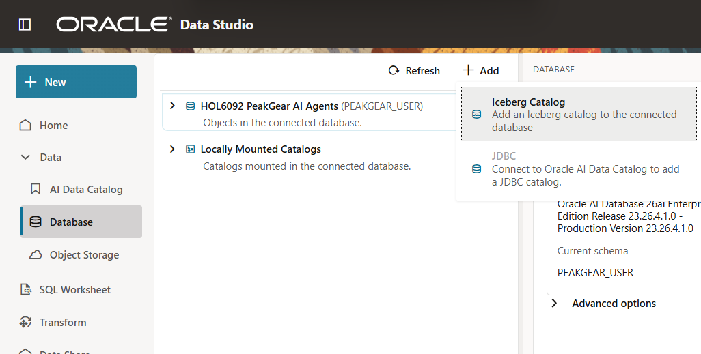
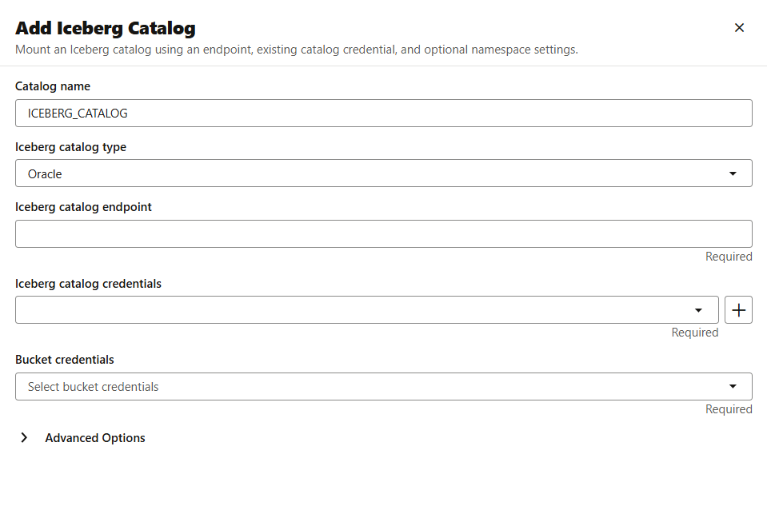
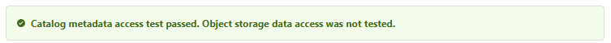
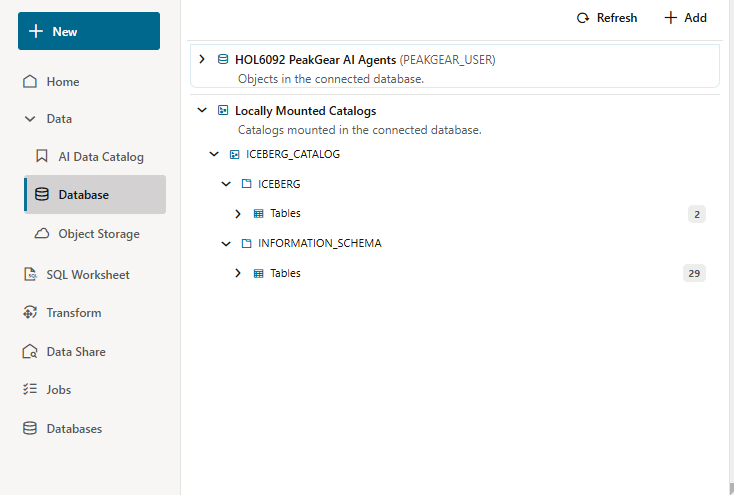
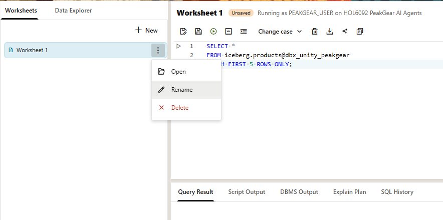
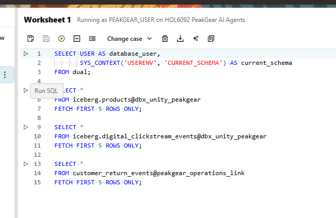
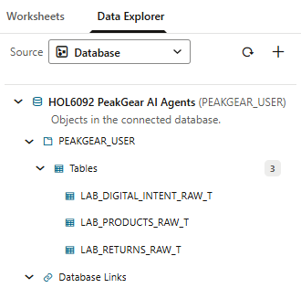

# Lab 2: Connect real sources

Estimated Time: 15 minutes

## Introduction

PeakGear connects two live systems:

* Databricks Unity Catalog supplies the Iceberg product catalog and digital
  clickstream events.
* The existing Oracle Operations database supplies return events through the
  public database link already provisioned for your LiveLabs reservation.

You will connect Databricks through the Data Studio UI using the source
credentials already created during provisioning, verify both live sources,
and create three participant-owned local tables. The first SQL checks
query data live where it already resides. You can continue querying those
connected sources without copying them. For the remaining exercises, we take
local snapshots so analysis is faster and Data Studio can enrich metadata on
the local tables. These copies do not refresh automatically.

### Objectives

In this lab, you will:

* identify the two provisioned source credentials;
* connect the Databricks Unity Iceberg catalog using those credentials;
* prove access to the two connected sources; and
* create the three raw business objects used by Codex.

## Task 1: Verify the provisioned source credentials

LiveLabs provisioning has already created both credentials for
PEAKGEAR&#95;USER in your assigned database:

| Credential | Purpose |
|---|---|
| ADLS&#95;PEAKGEAR&#95;DATA | Read the Iceberg files in Azure Blob Storage |
| DBX&#95;PEAKGEAR&#95;OAUTH | Authenticate to Databricks Unity Catalog |

In Data Studio, open the connected database's **Settings** (gear icon), then
select **Credentials**. Confirm that both names appear. You will select them
in Task 2; you do not create credentials or enter storage passwords, client
IDs, or client secrets.

If either credential is missing, stop and ask the instructor to check the
provisioned reservation. Include the missing credential name and your assigned
Database Name. The [Connection field reference](../assets/event-lab-values.md)
lists the prepared names and public connection settings.

## Task 2: Connect the Databricks Unity Catalog

In the left navigation, expand **Data**, select **Database**, then click
**Add > Iceberg Catalog**. **Database** is the connected database's data
browser; **Databases** is the separate page used to manage connections in Lab 1.

The form opens with defaults. Replace the example catalog name and type with
the values below, enter the public endpoint, and select the existing credentials:

| Field | Value |
|---|---|
| Catalog name | DBX&#95;UNITY&#95;PEAKGEAR |
| Iceberg catalog type | Unity |
| Iceberg catalog endpoint | https://adb-2242907740736663.3.azuredatabricks.net/api/2.1/unity-catalog/iceberg-rest/v1/catalogs/peakgear |
| Iceberg catalog credentials | Select DBX&#95;PEAKGEAR&#95;OAUTH |
| Bucket credentials | Select ADLS&#95;PEAKGEAR&#95;DATA |

The screenshot shows the form **before configuration**. For this workshop,
use **DBX&#95;UNITY&#95;PEAKGEAR** and **Unity**, not the displayed defaults.

Select DBX&#95;PEAKGEAR&#95;OAUTH in **Iceberg catalog credentials**, then select
ADLS&#95;PEAKGEAR&#95;DATA in **Bucket credentials**. Click **Test** and wait
for the result before clicking **Add**.

The expected message is **Catalog metadata access test passed. Object storage
data access was not tested.** This confirms access to catalog metadata, not
to the underlying Iceberg files. Task 3's sample queries verify data access.
If Test fails, keep the exact error and ask the instructor before adding the catalog.

After a successful test, click **Add** and wait for the catalog to appear in
**Data > Database**.
Expand **Locally Mounted Catalogs > DBX&#95;UNITY&#95;PEAKGEAR > ICEBERG > Tables**.
You should see **PRODUCTS** and **DIGITAL&#95;CLICKSTREAM&#95;EVENTS**. Use the
catalog's **Refresh** button only if the new connection or tables are not yet visible.

The screenshot's **ICEBERG&#95;CATALOG** is an example name. Your mount must be
**DBX&#95;UNITY&#95;PEAKGEAR**, as entered above, so the SQL in Task 3 can find it.

### SQL reference (not part of the lab)

> **For reference only:** The same Databricks Unity connection can also be
> configured in **SQL Worksheet**. This is not a required lab step; the UI
> workflow above remains the main path. If the catalog is already connected,
> skip this reference.

The [SQL reference](../scripts/02-unity-sql-reference.sql) reuses both source
credentials verified in **Task 1**. Open **SQL Worksheet** in your assigned
database as PEAKGEAR&#95;USER. No credential values or placeholders are needed.
The block checks the participant identity and both provisioned credentials,
then mounts the catalog only if it does not already exist. It does not create,
replace, refresh, or delete credentials.

Run the block below and wait for the worksheet's completion message.

~~~sql
<copy>
-- SQL reference only; not part of the required Lab 2 workflow.
-- Run as PEAKGEAR_USER with both source credentials already provisioned.
-- This block reuses credentials and mounts only when the catalog is absent.
DECLARE
  l_credential_count PLS_INTEGER;
  l_catalog_count PLS_INTEGER;
BEGIN
  IF USER <> 'PEAKGEAR_USER'
     OR SYS_CONTEXT('USERENV', 'CURRENT_SCHEMA') <> 'PEAKGEAR_USER' THEN
    RAISE_APPLICATION_ERROR(-20011,
      'Use SQL Worksheet connected as PEAKGEAR_USER in your assigned database.');
  END IF;

  SELECT COUNT(*) INTO l_credential_count
  FROM user_credentials
  WHERE credential_name IN ('ADLS_PEAKGEAR_DATA', 'DBX_PEAKGEAR_OAUTH');

  IF l_credential_count <> 2 THEN
    RAISE_APPLICATION_ERROR(-20014,
      'Provisioned source credentials are missing. Ask the instructor to repair this reservation.');
  END IF;

  SELECT COUNT(*) INTO l_catalog_count
  FROM user_mounted_catalogs
  WHERE catalog_name = 'DBX_UNITY_PEAKGEAR';

  IF l_catalog_count = 0 THEN
    DBMS_CATALOG.MOUNT_ICEBERG(
      catalog_name            => 'DBX_UNITY_PEAKGEAR',
      endpoint                =>
        'https://adb-2242907740736663.3.azuredatabricks.net/api/2.1/' ||
        'unity-catalog/iceberg-rest/v1/catalogs/peakgear',
      catalog_credential      => 'DBX_PEAKGEAR_OAUTH',
      data_storage_credential => 'ADLS_PEAKGEAR_DATA',
      enabled                 => TRUE,
      catalog_type            => 'ICEBERG_UNITY'
    );
  ELSE
    DBMS_OUTPUT.PUT_LINE(
      'DBX_UNITY_PEAKGEAR already exists. Continue with the sample reads in Lab 2 Task 3.');
  END IF;
END;
/
</copy>
~~~

After the block completes, refresh **Locally Mounted Catalogs** in **Data > Database**
if needed and confirm DBX&#95;UNITY&#95;PEAKGEAR contains
**ICEBERG → Tables → PRODUCTS** and **DIGITAL&#95;CLICKSTREAM&#95;EVENTS**.
The sample queries in Task 3 confirm read access. Continue there after a
successful mount or an already-existing-catalog message.

If a provisioned credential is missing or SQL reports an error, keep the exact
message and ask the instructor. After a timeout, inspect **Data > Database** before
trying again: the mount may already have completed. Do not drop or unmount
objects to force a retry.

## Task 3: Prove the two live sources

Open **SQL Worksheet** as PEAKGEAR&#95;USER. In the **Worksheets** tab, click
**New** if needed. Open the worksheet's three-dot menu, select **Rename**, enter
**PeakGear - Live source checks**, then click the **Save** (disk) icon in the
editor toolbar. Save again after adding your SQL.

Copy and run **each block separately**. The editor detects separate SQL
statements and shows a triangular **Run SQL** button in the left gutter beside
each one. Click the triangle beside the statement you want to execute, then
wait for its **Query Result** before running the next. Multiple statements in
the editor are not all executed by one statement's Run SQL button.

~~~sql
<copy>
SELECT *
FROM iceberg.products@dbx_unity_peakgear
FETCH FIRST 5 ROWS ONLY;
</copy>
~~~

~~~sql
<copy>
SELECT *
FROM iceberg.digital_clickstream_events@dbx_unity_peakgear
FETCH FIRST 5 ROWS ONLY;
</copy>
~~~

~~~sql
<copy>
SELECT *
FROM customer_return_events@peakgear_operations_link
FETCH FIRST 5 ROWS ONLY;
</copy>
~~~

Each query should return up to five sample rows. This confirms that you can
read the source without running a full row count. The prepared lab sources
should contain data; if a query returns no rows or an error, ask the instructor
to check the source before continuing. A sample does not prove product-key
uniqueness; that check runs against the local product table before analytics.

In **Worksheets**, click **New** and use the same **Rename** and **Save** steps
to create a second worksheet named **PeakGear - Local snapshots**.
Create the three raw, participant-owned tables by running
**each block separately**. Each `CREATE TABLE AS SELECT` can take time while it
copies source rows. Wait for the worksheet to report completion before starting
the next block. If you are resuming on the same database and a table already
exists, verify it in **Data Explorer** instead of recreating it. Do not replace a table
after saving its annotations in Lab 4. If an older run left `*_RAW_V` views in
the schema, leave them alone; this version uses the new `*_RAW_T` tables and
requires fresh table annotations in Lab 4.

~~~sql
<copy>
CREATE TABLE lab_products_raw_t AS
SELECT product_id,
       product_name,
       category AS category_name
FROM iceberg.products@dbx_unity_peakgear;
</copy>
~~~

~~~sql
<copy>
CREATE TABLE lab_digital_intent_raw_t AS
SELECT product_id,
       session_id,
       customer_id,
       CAST(event_ts AS TIMESTAMP) AS event_ts
FROM iceberg.digital_clickstream_events@dbx_unity_peakgear;
</copy>
~~~

~~~sql
<copy>
CREATE TABLE lab_returns_raw_t AS
SELECT product_id,
       store_id,
       return_qty,
       CAST(return_created_at AS TIMESTAMP) AS return_created_at
FROM customer_return_events@peakgear_operations_link;
</copy>
~~~

In SQL Worksheet, open the **Data Explorer** tab beside **Worksheets**. Set
**Source** to **Database**, expand your connected database, then expand
**PEAKGEAR&#95;USER > Tables**. Confirm that all three table names appear; use
the **Refresh** icon if the list has not updated after creation.

The tables are local copies at the time the statements ran; they do not refresh
automatically. They do not yet add business definitions. In **Data > Database**,
expand your database and **PEAKGEAR&#95;USER > Tables**, open each table's
**Sample Data**, and confirm that rows are present after creation completes.
Later labs use these local snapshots through Data Studio and the bounded MCP
server. Before joining product labels, MCP checks the local product table for
duplicate product keys. If duplicates are reported, ask the instructor to
investigate; do not deduplicate arbitrarily or invent a product mapping.

### Checkpoint

You can read both Iceberg tables and the Operations return table. The three
raw lab tables exist under PEAKGEAR&#95;USER.

## Learn More

* [Oracle Data Studio Guide](https://docs.oracle.com/en/cloud/paas/autonomous-database/data-studio-guide/)

## Acknowledgements

* **Author** - Oracle AI Lakehouse workshop team
* **Last Updated By/Date** - Oracle AI Lakehouse workshop team, November 2026
