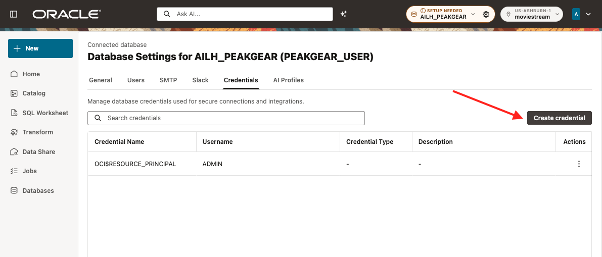
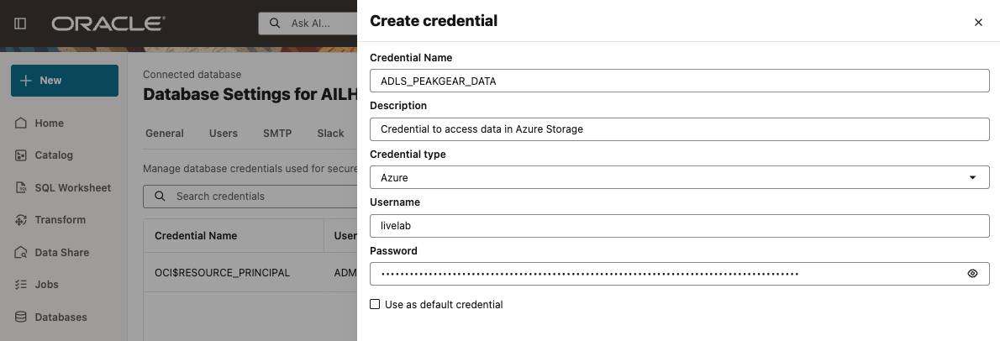
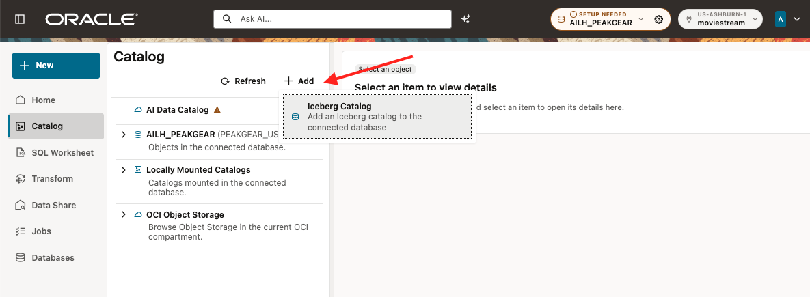
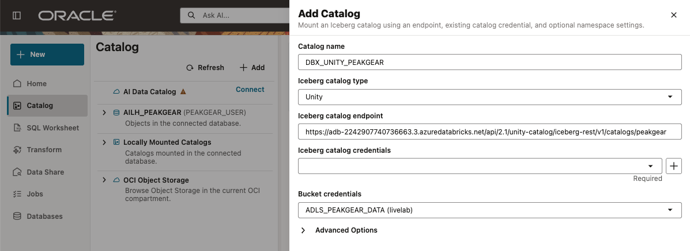
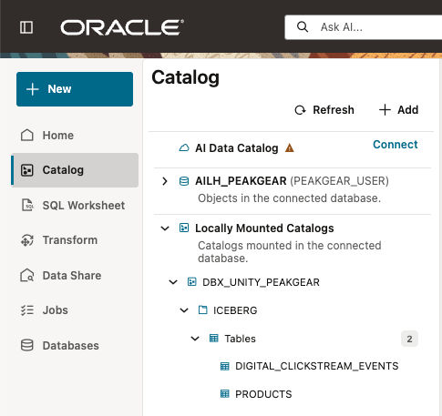

# Lab 2: Connect real sources

Estimated Time: 15 minutes

## Introduction

PeakGear connects two live systems:

* Databricks Unity Catalog supplies the Iceberg product catalog and digital
  clickstream events.
* The existing Oracle Operations database supplies return events through the
  public database link already provisioned for your LiveLabs reservation.

You will connect Databricks through the Data Studio UI, verify both live
sources, and create three participant-owned local tables. The first SQL checks
query data live where it already resides. You can continue querying those
connected sources without copying them. For the remaining exercises, we take
local snapshots so analysis is faster and Data Studio can enrich metadata on
the local tables. These copies do not refresh automatically.

### Objectives

In this lab, you will:

* create the Azure storage and Databricks OAuth credentials in Data Studio;
* connect the Databricks Unity Iceberg catalog;
* prove access to the two connected sources; and
* create the three raw business objects used by Codex.

## Task 1: Create the Azure storage credential in Data Studio

Open LiveLabs **View Login Info** (**Reservation Information**) and expand
**Environment Details**. You will need **Azure Storage Password**,
**Databricks Client ID**, and **Databricks Client Secret**. If any field is
missing or empty, stop and ask the instructor; do not look up old credentials
in GitHub, screenshots, or a previous reservation.

Keep this panel open. In Data Studio, open the connected database's
**Settings** (gear icon), then select **Credentials**. Public settings and
the private-field mapping are in the
[Connection field reference](../assets/event-lab-values.md). Do not paste
credentials into chat, source control, or screenshots.

Click **Create credential**. This credential lets AI Lakehouse read the
Iceberg files in Azure Blob Storage. Enter the values below in field order:

| Field | Value |
|---|---|
| Credential Name | ADLS&#95;PEAKGEAR&#95;DATA |
| Description | Credential to access data in Azure Storage |
| Credential type | Azure |
| Username | livelab |
| Password | Copy **Azure Storage Password** from **View Login Info → Environment Details** |

Save the credential. Confirm that ADLS&#95;PEAKGEAR&#95;DATA appears in
**Credentials** for the connected participant database. Task 1 is complete.

## Task 2: Connect the Databricks Unity Catalog

In **Catalog**, click **Add**, then choose **Iceberg catalog**.

Enter:

| Field | Value |
|---|---|
| Catalog name | DBX&#95;UNITY&#95;PEAKGEAR |
| Iceberg catalog type | Unity |
| Iceberg catalog endpoint | https://adb-2242907740736663.3.azuredatabricks.net/api/2.1/unity-catalog/iceberg-rest/v1/catalogs/peakgear |
| Iceberg catalog credentials | Create/select DBX&#95;PEAKGEAR&#95;OAUTH as described below |
| Bucket credentials | ADLS&#95;PEAKGEAR&#95;DATA |

When **Iceberg catalog credentials** is required, click the plus sign and
create the OAuth credential with these values:

| Field | Value |
|---|---|
| Credential Name | DBX&#95;PEAKGEAR&#95;OAUTH |
| Description | Credential to authenticate into Unity |
| Credential type | Iceberg OAuth2 |
| Token endpoint | https://adb-2242907740736663.3.azuredatabricks.net/oidc/v1/token |
| Client ID | Copy **Databricks Client ID** from **View Login Info → Environment Details** |
| Client secret | Copy **Databricks Client Secret** from **View Login Info → Environment Details** |
| Token scope | all-apis |
| Token refresh rate in seconds | 3600 |

Copy the two OAuth values directly from your reservation into this form.
Do not use Database Password as the client secret.

After saving the credential, return to the catalog form. Select
DBX&#95;PEAKGEAR&#95;OAUTH in **Iceberg catalog credentials**, then select
ADLS&#95;PEAKGEAR&#95;DATA in **Bucket credentials**. Click **Add**.
Expand **Locally Mounted Catalogs > DBX&#95;UNITY&#95;PEAKGEAR > ICEBERG > Tables**.
You should see **PRODUCTS** and **DIGITAL&#95;CLICKSTREAM&#95;EVENTS**. Use the
catalog's **Refresh** button only if the new connection or tables are not yet visible.

### SQL reference (not part of the lab)

> **For reference only:** The same Databricks Unity connection can also be
> configured in **SQL Worksheet**. This is not a required lab step; the UI
> workflow above remains the main path. If the catalog is already connected,
> skip this reference.

The [SQL reference](../scripts/02-unity-sql-reference.sql) below assumes
ADLS&#95;PEAKGEAR&#95;DATA was created in **Task 1**. Open **SQL Worksheet** in
your assigned database as PEAKGEAR&#95;USER. Before running it, replace only
the two placeholders with **Databricks Client ID** and **Databricks Client
Secret** from **View Login Info → Environment Details**. If either field is
missing or empty, ask the instructor. Never use an old screenshot or commit a
filled-in worksheet.

Run **each block separately, in order**, and wait for the worksheet's
completion message before starting the next block. Stop if either reports
an error.

The first block replaces **only DBX&#95;PEAKGEAR&#95;OAUTH**, if it exists.
It stops without changing anything if the user,
placeholders, or Azure credential are not ready, or if the catalog already
exists. The second block mounts the catalog. Neither block deletes the Azure
credential, unmounts a catalog, or changes source data.

~~~sql
<copy>
-- SQL reference only; not part of the required Lab 2 workflow.
-- Run in SQL Worksheet as PEAKGEAR_USER after creating ADLS_PEAKGEAR_DATA.
-- Fill both placeholders from your active reservation's View Login Info.
-- This replaces only DBX_PEAKGEAR_OAUTH, and only when the catalog is absent.
-- Do not share or commit a filled-in worksheet.
DECLARE
  l_client_id CONSTANT VARCHAR2(4000) := '<DATABRICKS_CLIENT_ID_FROM_VIEW_LOGIN_INFO>';
  l_client_secret CONSTANT VARCHAR2(4000) := '<DATABRICKS_CLIENT_SECRET_FROM_VIEW_LOGIN_INFO>';
  l_exists PLS_INTEGER;
BEGIN
  IF USER <> 'PEAKGEAR_USER'
     OR SYS_CONTEXT('USERENV', 'CURRENT_SCHEMA') <> 'PEAKGEAR_USER' THEN
    RAISE_APPLICATION_ERROR(-20011,
      'Use SQL Worksheet connected as PEAKGEAR_USER in your assigned database.');
  END IF;

  IF l_client_id IS NULL OR SUBSTR(l_client_id, 1, 1) = '<'
     OR l_client_secret IS NULL OR SUBSTR(l_client_secret, 1, 1) = '<' THEN
    RAISE_APPLICATION_ERROR(-20012,
      'Copy Databricks Client ID and Databricks Client Secret from LiveLabs View Login Info.');
  END IF;

  SELECT COUNT(*) INTO l_exists
  FROM user_mounted_catalogs
  WHERE catalog_name = 'DBX_UNITY_PEAKGEAR';

  IF l_exists > 0 THEN
    RAISE_APPLICATION_ERROR(-20013,
      'DBX_UNITY_PEAKGEAR already exists. Inspect it in Catalog; do not rerun connection setup.');
  END IF;

  SELECT COUNT(*) INTO l_exists
  FROM user_credentials
  WHERE credential_name = 'ADLS_PEAKGEAR_DATA';

  IF l_exists = 0 THEN
    RAISE_APPLICATION_ERROR(-20014,
      'Complete Lab 2 Task 1 first: ADLS_PEAKGEAR_DATA is required.');
  END IF;

  SELECT COUNT(*) INTO l_exists
  FROM user_credentials
  WHERE credential_name = 'DBX_PEAKGEAR_OAUTH';

  IF l_exists > 0 THEN
    DBMS_CLOUD.DROP_CREDENTIAL('DBX_PEAKGEAR_OAUTH');
  END IF;

  DBMS_SHARE.CREATE_BEARER_TOKEN_CREDENTIAL(
    credential_name => 'DBX_PEAKGEAR_OAUTH',
    token_endpoint  =>
      'https://adb-2242907740736663.3.azuredatabricks.net/oidc/v1/token',
    client_id       => l_client_id,
    client_secret   => l_client_secret,
    token_scope     => 'all-apis'
  );
END;
/
</copy>
~~~

After the credential block completes successfully, run the mount block:

~~~sql
<copy>
BEGIN
  DBMS_CATALOG.MOUNT_ICEBERG(
    catalog_name            => 'DBX_UNITY_PEAKGEAR',
    endpoint                =>
      'https://adb-2242907740736663.3.azuredatabricks.net/api/2.1/' ||
      'unity-catalog/iceberg-rest/v1/catalogs/peakgear',
    catalog_credential      => 'DBX_PEAKGEAR_OAUTH',
    data_storage_credential => 'ADLS_PEAKGEAR_DATA',
    enabled                 => TRUE,
    catalog_type            => 'ICEBERG_UNITY'
  );
END;
/
</copy>
~~~

After both blocks complete, refresh **Locally Mounted Catalogs** in
**Catalog** if needed and confirm
DBX&#95;UNITY&#95;PEAKGEAR contains **ICEBERG → Tables → PRODUCTS** and
**DIGITAL&#95;CLICKSTREAM&#95;EVENTS**. The sample queries in Task 3 confirm
read access; this reference does not replace those checks. Do not repeat the
UI connection setup after a successful SQL mount.

If SQL reports an error, keep its exact message and ask the instructor.
Credential creation and catalog mounting are separate operations: an error
does not guarantee that nothing was created. After a timeout, inspect
**Credentials** and **Catalog** before trying again; do not drop or unmount
objects to force a retry.

## Task 3: Prove the two live sources

Open SQL Worksheet as PEAKGEAR&#95;USER and save a worksheet named
**PeakGear - Live source checks**. Copy and run **each block separately**;
Run SQL executes the current statement, not every statement in a pasted script.

~~~sql
<copy>
SELECT *
FROM iceberg.products@dbx_unity_peakgear
FETCH FIRST 5 ROWS ONLY;
</copy>
~~~

~~~sql
<copy>
SELECT *
FROM iceberg.digital_clickstream_events@dbx_unity_peakgear
FETCH FIRST 5 ROWS ONLY;
</copy>
~~~

~~~sql
<copy>
SELECT *
FROM customer_return_events@peakgear_operations_link
FETCH FIRST 5 ROWS ONLY;
</copy>
~~~

Each query should return up to five sample rows. This confirms that you can
read the source without running a full row count. The prepared lab sources
should contain data; if a query returns no rows or an error, ask the instructor
to check the source before continuing. A sample does not prove product-key
uniqueness; that check runs against the local product table before analytics.

Create and save a second worksheet named **PeakGear - Local snapshots**.
Create the three raw, participant-owned tables by running
**each block separately**. Each `CREATE TABLE AS SELECT` can take time while it
copies source rows. Wait for the worksheet to report completion before starting
the next block. If you are resuming on the same database and a table already
exists, verify it in Catalog instead of recreating it. Do not replace a table
after saving its annotations in Lab 4. If an older run left `*_RAW_V` views in
the schema, leave them alone; this version uses the new `*_RAW_T` tables and
requires fresh table annotations in Lab 4.

~~~sql
<copy>
CREATE TABLE lab_products_raw_t AS
SELECT product_id,
       product_name,
       category AS category_name
FROM iceberg.products@dbx_unity_peakgear;
</copy>
~~~

~~~sql
<copy>
CREATE TABLE lab_digital_intent_raw_t AS
SELECT product_id,
       session_id,
       customer_id,
       CAST(event_ts AS TIMESTAMP) AS event_ts
FROM iceberg.digital_clickstream_events@dbx_unity_peakgear;
</copy>
~~~

~~~sql
<copy>
CREATE TABLE lab_returns_raw_t AS
SELECT product_id,
       store_id,
       return_qty,
       CAST(return_created_at AS TIMESTAMP) AS return_created_at
FROM customer_return_events@peakgear_operations_link;
</copy>
~~~

In Catalog, check **Tables** under PEAKGEAR&#95;USER for all three names. The
tables are local copies at the time the statements ran; they do not refresh
automatically. They do not yet add business definitions. Open **Sample Data**
for each table and confirm that rows are present after creation completes.
Later labs use these local snapshots through Data Studio and the bounded MCP
server. Before joining product labels, MCP checks the local product table for
duplicate product keys. If duplicates are reported, ask the instructor to
investigate; do not deduplicate arbitrarily or invent a product mapping.

### Checkpoint

You can read both Iceberg tables and the Operations return table. The three
raw lab tables exist under PEAKGEAR&#95;USER.

## Learn More

* [Oracle Data Studio Guide](https://docs.oracle.com/en/cloud/paas/autonomous-database/data-studio-guide/)

## Acknowledgements

* **Author** - Oracle AI Lakehouse workshop team
* **Last Updated By/Date** - Oracle AI Lakehouse workshop team, October 2026
