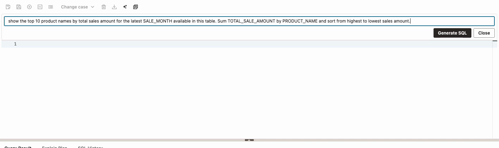
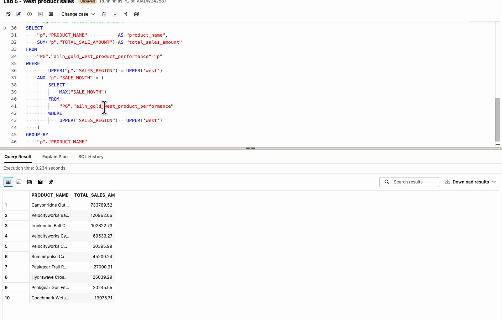

# Lab 5: Ask business questions of Gold with AI

## Introduction

**Mia** wants two answers: which products led sales overall in the latest available month, and which led in the West.

You will use SQL Worksheet's AI to generate both queries, check their sources and latest-month logic, then compare the West result with reference SQL. The questions cover different scopes, so their rankings can differ.

**Estimated Time:** 8 minutes.

### Objectives

* Ask two natural-language questions in SQL Worksheet.
* Inspect and, if needed, repair the generated SQL before running it.
* Check the Gold sources, reporting month, grouping, and West-region totals against reference SQL.

### Prerequisites

* Complete **Lab 4**. 
  * Both `PG."ailh_enriched_sales"` and the West-only `PG."ailh_gold_west_product_performance"` must be queryable.
  * The event's SQL-generation configuration is pre-provisioned.

## Task 1: Open the worksheet AI prompt

1. Open **SQL Worksheet**. Rename a blank worksheet, or create one named **Lab 5 - West product sales**.

2. In **Data Explorer**, choose **Source** → **Database** and expand **your connected database** → **PG** → **Tables**.
  <details>
    <summary><strong>Expand to see the tables to query</strong></summary>

      > - Locate `ailh_enriched_sales` and `ailh_gold_west_product_performance`.
      > - Both are native `PG` tables, separate from the mounted Silver Iceberg table.
  </details>

3. Open the AI prompt and submit the question from there.
  <details>
    <summary><strong>Expand to submit a question</strong></summary>

      > - Click **Generate SQL with AI** in the worksheet toolbar.
      > - Enter the question in the prompt bar above the SQL editor, not in the editor, then click **Generate SQL**.
  </details>

    

## Task 2: Ask and check two questions

1. Generate SQL for the first question:

    ```text
    <copy>
    show the top 10 product names by total sales amount for the latest month. Sum sale amount by product name and sort from highest to lowest sales amount.
    </copy>
    ```

2. Review the generated SQL before running it.
  <details>
    <summary><strong>Expand to review the generated SQL</strong></summary>

      > - Check every `FROM` clause, including any latest-month subquery. The general-sales query currently targets `PG."ailh_enriched_sales"`.
      > - Confirm it uses `MAX(SALE_MONTH)`, sums `TOTAL_SALE_AMOUNT` by `PRODUCT_NAME`, sorts from highest to lowest, and returns ten rows.
      > - Repair an incorrect source or calculation, then run the query.
  </details>

3. Use **Generate SQL with AI** again for the second question:

    ```text
    <copy>
    using the west performance data, show the top 10 product names by total sales amount for the latest month. Sum sale amount by product name and sort from highest to lowest sales amount.
    </copy>
    ```

4. Review the second query before running it.
  <details>
    <summary><strong>Expand to review the West query</strong></summary>

      > - Check every `FROM` clause, including any latest-month subquery, for `PG."ailh_gold_west_product_performance"`.
      > - Confirm the same latest-month, sum, sort, and ten-row requirements as for the first query.
      > - Repair the SQL if needed, then run it. The table already contains only West-region rows, so an additional West filter is optional.
  </details>

    

## Task 3: Validate the answer

1. In a separate worksheet, run this reference calculation for the West-region answer so you can compare it with the AI-generated result.

    ```sql
    <copy>
    SELECT
        a."PRODUCT_NAME" AS product_name,
        SUM(a."TOTAL_SALE_AMOUNT") AS total_sales_amount
    FROM "PG"."ailh_gold_west_product_performance" a
    WHERE a."SALE_MONTH" = (
        SELECT MAX(b."SALE_MONTH")
        FROM "PG"."ailh_gold_west_product_performance" b
    )
    GROUP BY a."PRODUCT_NAME"
    ORDER BY total_sales_amount DESC
    FETCH FIRST 10 ROWS ONLY;
    </copy>
    ```

2. Compare the leading product and sales amount with the West-region AI result. Do not compare the overall-sales result with this West-only reference.
  <details>
    <summary><strong>Expand for result follow-up</strong></summary>

      > - If the worksheet offers a visualization action, use it to chart the top products.
      > - Save your worksheets.
  </details>

3. Explain why the two answers may differ.
  <details>
    <summary><strong>Expand to compare query scopes</strong></summary>

      > - The first query ranks products across `PG."ailh_enriched_sales"`; the second covers the West region only.
      > - Catalog descriptions and tags add context. The generated SQL determines each query's scope.
  </details>

    **Checkpoint:** both natural-language prompts lead to reviewed, executable SQL against native PG tables. The West-region result agrees with the reference calculation. Running the reference query alone does not complete the AI exercise.

## Learn More

* [Use the AI Assistant in Data Studio](https://docs.oracle.com/en/cloud/paas/autonomous-database/data-studio-guide/use-ai-assistant.html)
* [Select AI concepts](https://docs.oracle.com/en-us/iaas/autonomous-database-serverless/doc/select-ai-concepts.html)

You may now **proceed to the next lab**.

## Acknowledgements

* **Authors** - Ashish Jain, Sofia Arceo
* **Contributors** - Teodor C. Nechita
* **Last Updated By/Date** - Teodor C. Nechita, November 2026
