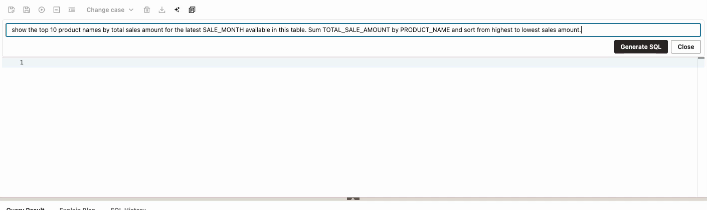
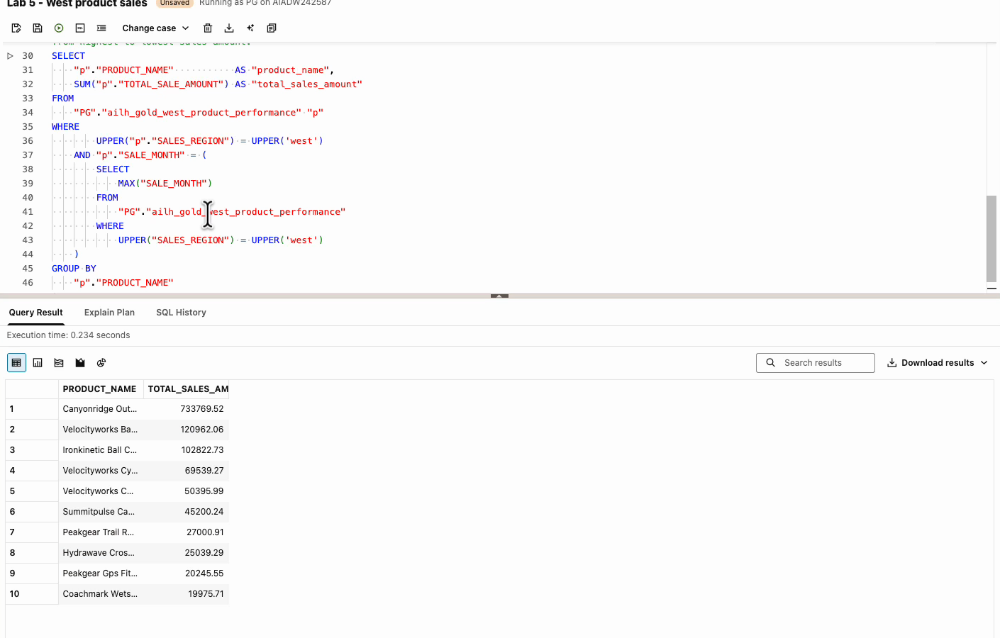

# Lab 5: Ask business questions of Gold with AI

## Introduction

Mia first asks which products lead sales overall in the latest available month. She then narrows the question to the West region. You will generate SQL for both questions in Data Studio and check which native table in the PG Gold schema answers each one. Because the questions have different scopes, their rankings may differ.

Estimated Time: 8 minutes.

### Objectives

* Ask two natural-language questions in SQL Worksheet.
* Inspect and, if needed, repair the generated SQL before running it.
* Check the Gold sources, reporting month, grouping, and West-region totals against reference SQL.

### Prerequisites

Complete Lab 4. Both `PG."ailh_enriched_sales"` and the West-only `PG."ailh_gold_west_product_performance"` must be queryable. The event's SQL-generation configuration is pre-provisioned.

## Task 1: Open the worksheet AI prompt

1. Open **SQL Worksheet**. Create a worksheet, or rename a blank one, to **Lab 5 - West product sales**.

2. In the worksheet's **Data Explorer** pane, choose **Source** → **Database**, then expand **your connected database** → **PG** → **Tables**. Locate `ailh_enriched_sales` and `ailh_gold_west_product_performance`. Both are native PG tables, distinct from the mounted Silver Iceberg table.

3. Click the sparkle **Generate SQL with AI** control in the worksheet toolbar. Enter your question in the prompt bar that opens above the SQL editor—not in the SQL editor itself—then click **Generate SQL**.

    

## Task 2: Ask and check two questions

1. Generate SQL for the first question:

    ```text
    <copy>
    show the top 10 product names by total sales amount for the latest month. Sum sale amount by product name and sort from highest to lowest sales amount.
    </copy>
    ```

2. Before running it, inspect **every** `FROM` clause, including any latest-month subquery. Confirm that the general sales question uses `"PG"."ailh_enriched_sales"`. The query must use `MAX(SALE_MONTH)`, sum `TOTAL_SALE_AMOUNT` by `PRODUCT_NAME`, sort descending, and return ten rows. Repair the generated SQL if its source or calculation is wrong, then run it.

3. Use **Generate SQL with AI** again for the second question:

    ```text
    <copy>
    using the west performance data, show the top 10 product names by total sales amount for the latest month. Sum sale amount by product name and sort from highest to lowest sales amount.
    </copy>
    ```

4. Apply the same source and calculation checks before running it. Confirm that the West question uses `"PG"."ailh_gold_west_product_performance"` in both the main query and any latest-month subquery. Repair the SQL if needed, then run it. This table already contains only West-region rows, so an additional West filter is optional.

    

## Task 3: Validate the answer

1. In a separate worksheet, run the reference calculation for the West-region answer:

    ```sql
    <copy>
    SELECT
        a."PRODUCT_NAME" AS product_name,
        SUM(a."TOTAL_SALE_AMOUNT") AS total_sales_amount
    FROM "PG"."ailh_gold_west_product_performance" a
    WHERE a."SALE_MONTH" = (
        SELECT MAX(b."SALE_MONTH")
        FROM "PG"."ailh_gold_west_product_performance" b
    )
    GROUP BY a."PRODUCT_NAME"
    ORDER BY total_sales_amount DESC
    FETCH FIRST 10 ROWS ONLY;
    </copy>
    ```

2. Compare the leading product and sales amount with the West-region AI result. Do not compare the overall result with this West-only reference. If the worksheet offers a visualization action, use it to chart the top products. Save your worksheets.

3. Explain the two answers separately: the first ranks products across the data in `PG."ailh_enriched_sales"`; the second ranks products for the West region only. Catalog descriptions and tags provide useful context, but check the generated SQL to confirm each answer's scope.

    **Checkpoint:** both natural-language prompts lead to reviewed, executable SQL against native PG tables. The West-region result agrees with the reference calculation. Running the reference query alone does not complete the AI exercise.

## Learn More

* [Use the AI Assistant in Data Studio](https://docs.oracle.com/en/cloud/paas/autonomous-database/data-studio-guide/use-ai-assistant.html)
* [Select AI concepts](https://docs.oracle.com/en-us/iaas/autonomous-database-serverless/doc/select-ai-concepts.html)

You may now **proceed to the next lab**.

## Acknowledgements

* **Author** - Oracle AI Lakehouse workshop team
* **Last Updated By/Date** - Oracle AI Lakehouse workshop team, October 2026
