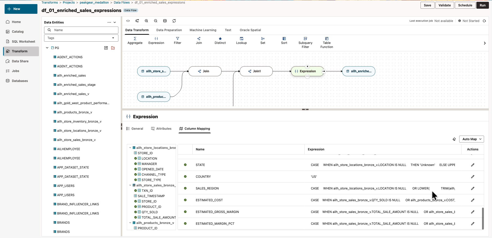
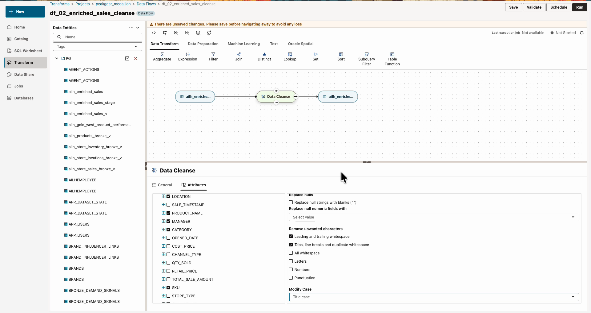
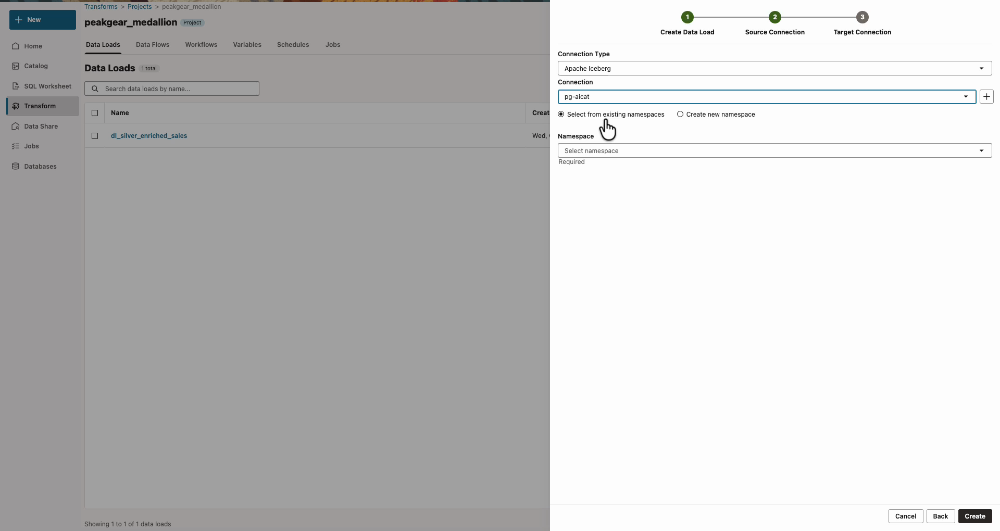
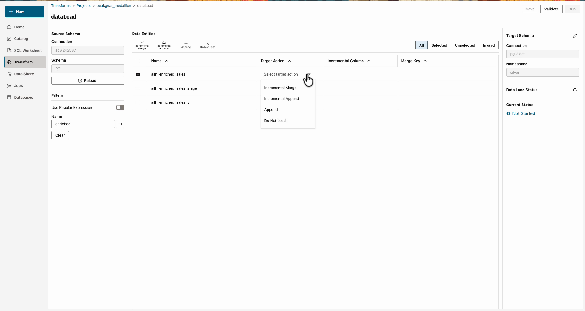
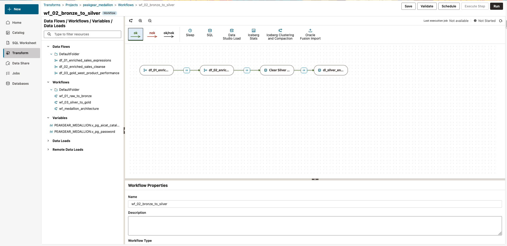
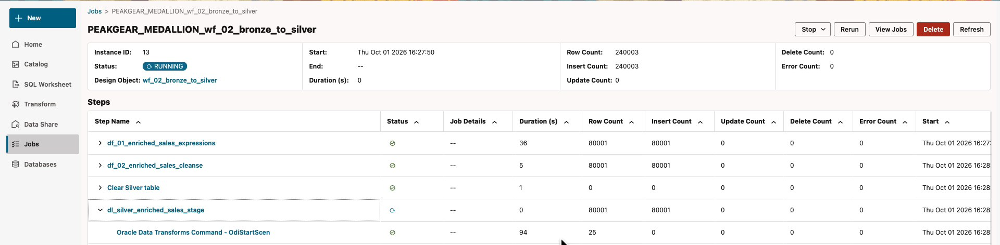
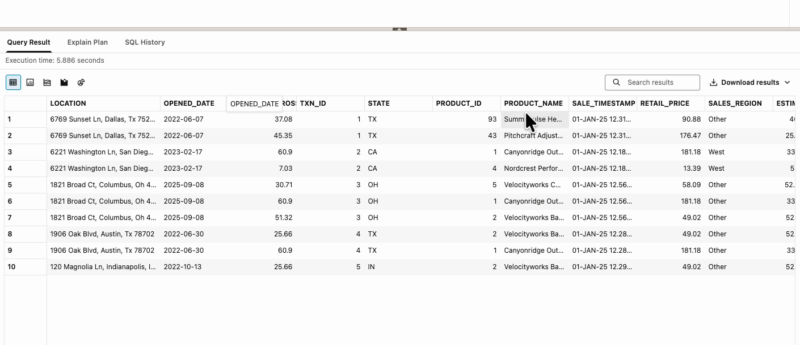

# Lab 2: Build reusable Silver sales data

## Introduction

Alex turns source sales, product, and store data into a reusable sales dataset. Inspect Bronze, review the prepared visual transformations, and run the workflow that publishes Silver Iceberg data.

Estimated Time: 27 minutes for the core path. The optional Data Load exercise is outside the 90-minute agenda.

### Objectives

* Browse and query Bronze Iceberg tables.
* Register the prepared Bronze bridge views.
* Review derived sales measures and set the product-name cleansing rule.
* Run the Silver workflow and inspect its child jobs.

### Prerequisites

Complete Lab 1. Use your assigned environment and the `peakgear_medallion` project.

## Task 1: Watch the Raw-to-Bronze overview

1. Follow the facilitator's explanation of the prepared ingestion: PeakGear source files are loaded into Bronze Iceberg tables through Data Transforms.

2. Open **Data** → **Database** → **Locally Mounted Catalogs** → `PG_AICAT` → **bronze** → **Tables**. Select any table and open **Sample Data**. If you already sampled `products` in Lab 1, choose `store_inventory` here.

3. Identify the other two Bronze tables: `store_sales_transactions` and `store_locations`. All four are preloaded. You will not reload raw files in this exercise.

    Facilitator: “The catalog lets us find and query open tables. Their data files remain in object storage. The next workflow registers views so our prepared Data Transforms flows can refer to those tables.”

## Task 2: Query Bronze in SQL Worksheet

1. Open **SQL Worksheet**. If a blank **Worksheet 1** is open, rename it **Lab 2 - Bronze checks** from its three-dot menu. Otherwise click **New** and name the worksheet. Save it.

2. Paste and execute each statement separately. Put the cursor in the statement, then click the arrow beside **Run Statement** or use the worksheet's **Run Statement** control. First, list the catalog tables.

    ```sql
    <copy>
    SELECT owner, table_name
    FROM all_tables@PG_AICAT
    ORDER BY owner, table_name;
    </copy>
    ```

3. Query the products table. Keep the lowercase quoted table name.

    ```sql
    <copy>
    SELECT * FROM "bronze"."products"@PG_AICAT
    FETCH FIRST 10 ROWS ONLY;
    </copy>
    ```

4. Inspect the inventory fields that Sam will use.

    ```sql
    <copy>
    SELECT "STORE_ID", "PRODUCT_ID", "STOCK_ON_HAND",
           "AVAILABLE_TO_PROMISE_QTY", "REORDER_LEVEL", "INVENTORY_STATUS"
    FROM "bronze"."store_inventory"@PG_AICAT
    FETCH FIRST 10 ROWS ONLY;
    </copy>
    ```

    **Checkpoint:** the catalog listing includes the four Bronze tables, and both sample queries return data.

## Task 3: Register views and review the transformations

1. Open **Transform** → **Projects** → `peakgear_medallion` → **Workflows** → `wf_01_raw_to_bronze`.

2. Review the prepared **Create Bronze** view-registration step. In this event project, Bronze data already exists; this workflow creates the database views used by the downstream data flows. It is not another raw-data load.

3. Click **Run** at the upper right. Retain the pre-provisioned variable defaults if the **Variable values** dialog opens, then click **OK**. Do not expose or replace the variable values.

4. Open **Jobs → Transforms**, select the `wf_01_raw_to_bronze` run, and click **Refresh** until it finishes successfully. Continue only after success.

5. Return to **Transform** → **Projects** → `peakgear_medallion` → **Data Flows** → `df_01_enriched_sales_expressions`.

6. Select the **Expression** step, then the **Column Mapping** tab in the lower panel. Scroll the mapping rows to inspect `COUNTRY`, which is set to `'US'`, and the expressions for sales region, estimated cost, and margin.

    

7. Trace the joins from the Bronze sales, products, and store-location views into the expression and target. These views expose catalog data to the flow; they are not a second copy of the Bronze files.

8. Leave the prepared expression mapping unchanged. Open **Data Flows** → `df_02_enriched_sales_cleanse`. Select the **Data Cleanse** step, then **Attributes**. Select `PRODUCT_NAME` and set **Modify Case** to **Title case**. Click **Save**. This standardizes inconsistent Bronze product names before publication.

    

9. Do not run the individual flows. The workflow executes expression, cleansing, and publication steps in order. The visual step names may still be generic in the imported project; identify each by its position and selected detail panel.

    Facilitator: “The visual flow joins source data and derives sales measures. You changed one cleansing rule; the workflow will apply it and publish reusable Silver Iceberg data.”

## Optional: Build the Silver Iceberg Data Load

Do this only if your facilitator confirms there is extra time and each attendee has an isolated project. The core workflow already has a prepared Data Load; do not alter a shared or running workflow. Otherwise, go directly to Task 4.

1. In `peakgear_medallion`, open **Data Loads** and create a new Data Load named `dl_silver_enriched_sales_practice`.
2. For **Source Connection**, choose **Oracle**, your assigned database connection, and schema `PG`. For **Target Connection**, choose **Apache Iceberg**, the prepared `pg-aicat` connection, and the existing `silver` namespace. This connection is the Data Transforms target; `PG_AICAT` is the SQL mount.

    

3. In **Data Entities**, search `enriched`, select `ailh_enriched_sales` (not the stage table or view), and set **Target Action** to **Append**. Validate and save the Data Load.

    

4. Before running `wf_02_bronze_to_silver`, replace only its final prepared Data Load step with your new one, connect **Clear Silver table** to it using an **ok** transition, then validate and save the workflow. The clear step must remain in place so reruns do not append duplicates. If your project does not allow this safely, keep the prepared load and continue with Task 4.

## Task 4: Execute and monitor Silver

1. Open **Workflows** → `wf_02_bronze_to_silver` in `peakgear_medallion`.

    

2. Review the sequence.

    | Prepared step | Purpose |
    |---|---|
    | `df_01_enriched_sales_expressions` | Join Bronze views and derive sales fields |
    | `df_02_enriched_sales_cleanse` | Cleanse the native intermediate data |
    | `Clear Silver table` | Clear the disposable lab target before loading |
    | Final Silver Data Load, such as `dl_silver_enriched_sales` | Publish the curated data to Silver Iceberg; an optional replacement uses your practice load |

3. Confirm that you are in your assigned lab environment. This workflow clears its Silver target. Click **Run** once, retain the prepared variable defaults, and click **OK**.

4. Open **Jobs → Transforms**. Select the new `wf_02_bronze_to_silver` run by its start time. You can also follow the workflow's latest-execution job link.

5. Click **Refresh** while the job runs. Expand the child steps to inspect their status. Allow about two to three minutes; timings can vary. Wait for the workflow and all its children to finish successfully before moving on.

    

    The screenshot illustrates monitoring an in-progress run. The workflow total can count the same rows at multiple stages; it is not the final Silver table count.

## Task 5: Check published Silver

1. Open **Data** → **Database** → **Locally Mounted Catalogs** → `PG_AICAT`, click **Refresh**, and expand **silver** → **Tables** → `AILH_ENRICHED_SALES`. Inspect **Sample Data**.

2. Open a new worksheet named **Lab 2 - Silver checks**. Execute the checks separately. The first shows the published rows; the second makes the cleansed names and derived measures easier to compare.

    ```sql
    <copy>
    SELECT *
    FROM "silver"."AILH_ENRICHED_SALES"@PG_AICAT
    FETCH FIRST 10 ROWS ONLY;
    </copy>
    ```

    ```sql
    <copy>
    SELECT "PRODUCT_ID", "PRODUCT_NAME", "SALE_MONTH", "SALES_REGION",
           "QTY_SOLD", "TOTAL_SALE_AMOUNT", "ESTIMATED_COST",
           "ESTIMATED_GROSS_MARGIN"
    FROM "silver"."AILH_ENRICHED_SALES"@PG_AICAT
    FETCH FIRST 10 ROWS ONLY;
    </copy>
    ```

3. Compare `PRODUCT_NAME` with the raw Bronze sample: names are now title-cased. `TOTAL_SALE_AMOUNT`, `ESTIMATED_COST`, and `ESTIMATED_GROSS_MARGIN` are reusable sales measures derived during preparation. Save the worksheet.

    

    **Checkpoint:** the Silver workflow succeeded and the published Iceberg table returns enriched sales data.

## Learn More

* [Manage catalogs with DBMS_CATALOG](https://docs.oracle.com/en-us/iaas/autonomous-database-serverless/doc/manage-catalogs-dbms-catalogs.html)
* [Create a Data Load in Data Transforms](https://docs.oracle.com/en/database/data-integration/data-transforms/using/create-data-load.html)

You may now **proceed to the next lab**.

## Acknowledgements

* **Author** - Oracle AI Lakehouse workshop team
* **Last Updated By/Date** - Oracle AI Lakehouse workshop team, October 2026
