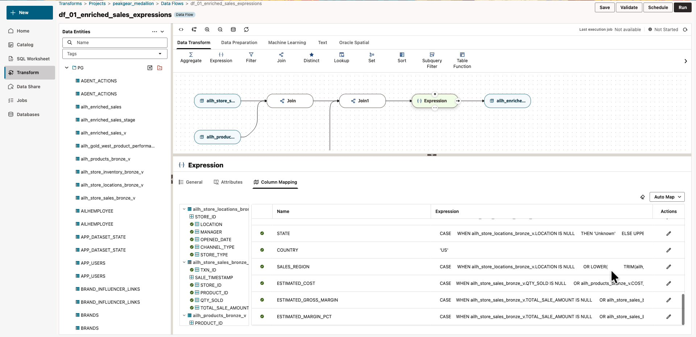
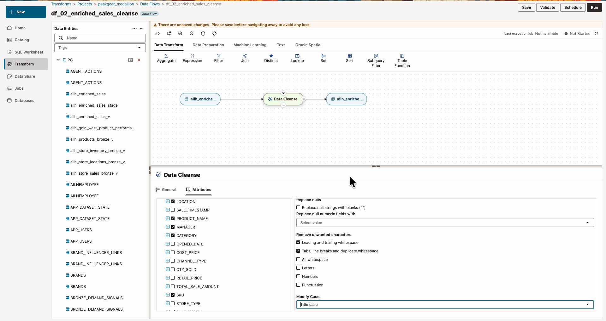
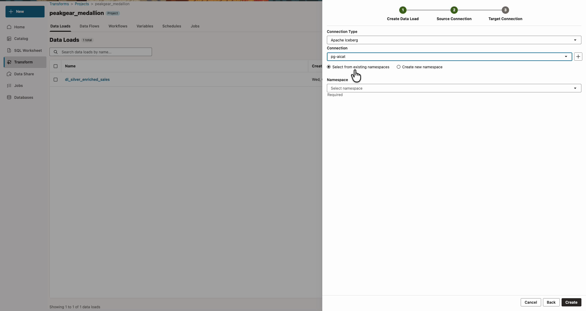
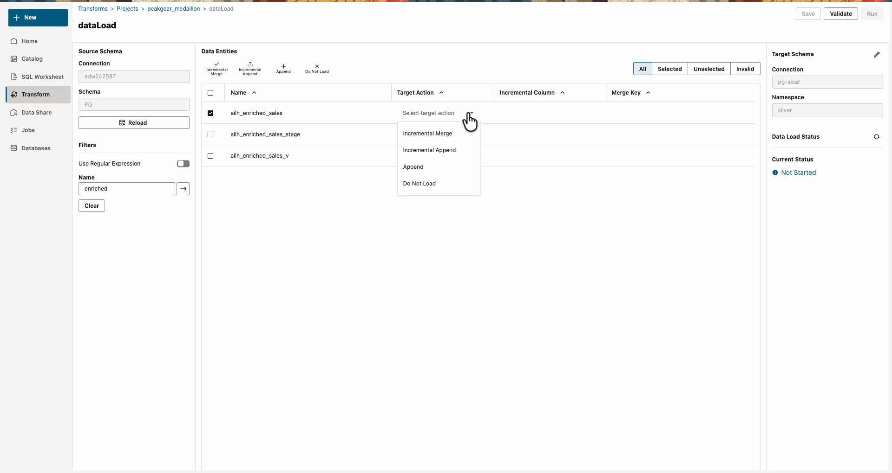
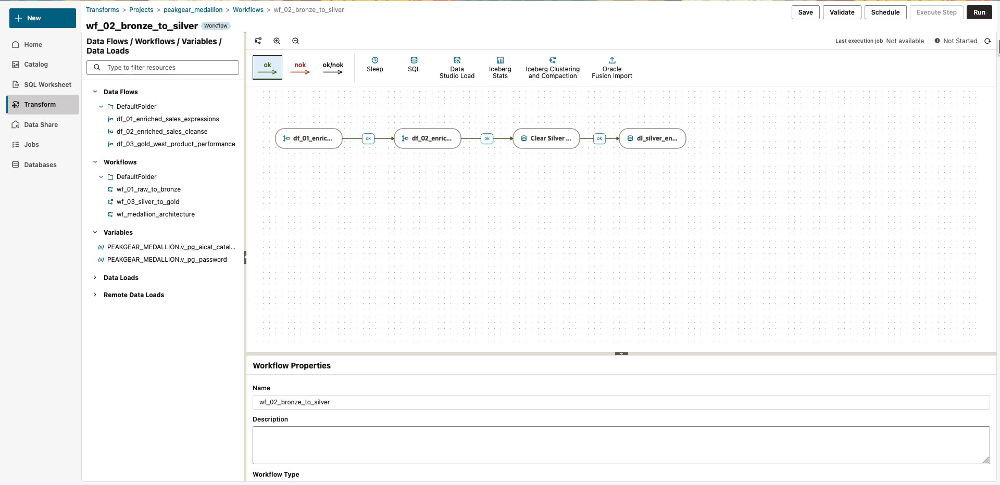
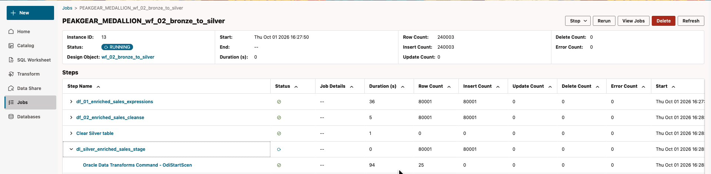
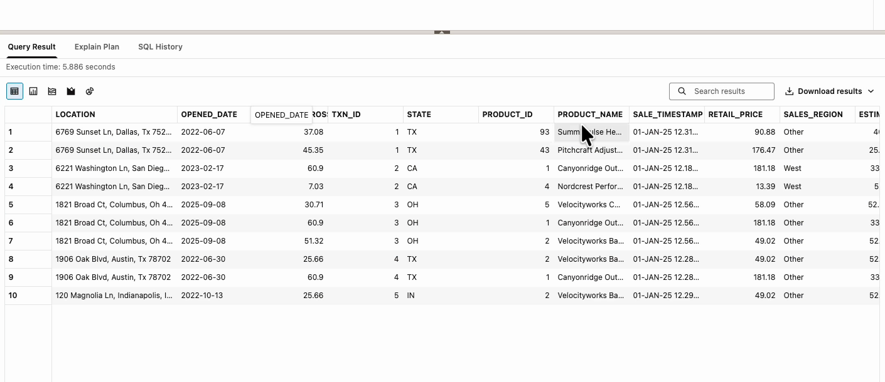

# Lab 2: Build reusable Silver sales data

## Introduction

**PeakGear**'s sales, product, and store data are already loaded in **Bronze**, but analysts need a consistent sales dataset they can reuse.

In this lab, you will inspect Bronze, review the prepared transformations, set the product-name cleansing rule, and run the workflow that publishes enriched sales to Silver Iceberg. The optional Data Load exercise is separate from the core path.

**Estimated Time:** 27 minutes for the core path. The optional Data Load exercise is outside the 90-minute agenda.

### Objectives

* Browse and query Bronze Iceberg tables.
* Register the prepared Bronze bridge views.
* Review derived sales measures and set the product-name cleansing rule.
* Run the Silver workflow and inspect its child jobs.

### Prerequisites

* Complete **Lab 1**. Use your assigned environment and the `peakgear_medallion` project.

## Task 1: Watch the Raw-to-Bronze overview

1. Follow the facilitator's overview of the prepared ingestion. **Data Transforms** loads the PeakGear source files into Bronze Iceberg tables.

2. Open **Sample Data** for a Bronze table.
  <details>
    <summary><strong>Expand to see the catalog path</strong></summary>

      > - Go to **Data** → **Database** → **Locally Mounted Catalogs** → `PG_AICAT` → **bronze** → **Tables** and select a table.
      > - Choose `store_inventory` if you already sampled `products` in Lab 1.
  </details>

3. Confirm the other Bronze tables, `store_sales_transactions` and `store_locations`, are present. All four are preloaded, so do not reload raw files.

    ```text
    Facilitator: “The catalog lets us find and query open tables. Their data files remain in object storage. The next workflow registers views so our prepared Data Transforms flows can refer to those tables.”
    ```

## Task 2: Query Bronze in SQL Worksheet

1. Create and save a worksheet named **Lab 2 - Bronze checks**.
  <details>
    <summary><strong>Expand to see worksheet options</strong></summary>

      > - Open **SQL Worksheet**.
      > - If a blank **Worksheet 1** is open, rename it from its three-dot menu. Otherwise click **New** and name the worksheet.
  </details>

2. Run the catalog query to list the mounted tables.

    ```sql
    <copy>
    SELECT owner, table_name
    FROM all_tables@PG_AICAT
    ORDER BY owner, table_name;
    </copy>
    ```

  <details>
    <summary><strong>Expand to see how to run the query</strong></summary>

      > - Place the cursor in the statement, then click the arrow beside **Run Statement** or use the worksheet's **Run Statement** control.
      > - Run each later query separately.
  </details>

3. Query the Bronze products table. Keep its lowercase quoted name.

    ```sql
    <copy>
    SELECT * FROM "bronze"."products"@PG_AICAT
    FETCH FIRST 10 ROWS ONLY;
    </copy>
    ```

4. Check the inventory fields Sam will use.

    ```sql
    <copy>
    SELECT "STORE_ID", "PRODUCT_ID", "STOCK_ON_HAND",
           "AVAILABLE_TO_PROMISE_QTY", "REORDER_LEVEL", "INVENTORY_STATUS"
    FROM "bronze"."store_inventory"@PG_AICAT
    FETCH FIRST 10 ROWS ONLY;
    </copy>
    ```

    **Checkpoint:** the catalog listing includes the four Bronze tables, and both sample queries return data.

## Task 3: Register views and review the transformations

1. Open **Transform** → **Projects** → `peakgear_medallion` → **Workflows** → `wf_01_raw_to_bronze`.

2. Review the prepared **Create Bronze** view-registration step. Bronze data already exists in this event project; the workflow creates database views for downstream data flows and does not load the raw files again.

3. Run the workflow from the upper right.
  <details>
    <summary><strong>Expand for workflow run settings</strong></summary>

      > - Keep the pre-provisioned defaults if the **Variable values** dialog opens, then click **OK**.
      > - Do not expose or replace the variable values.
  </details>

4. In **Jobs** → **Transforms**, select the `wf_01_raw_to_bronze` run and click **Refresh** until it succeeds.

5. Return to **Transform** → **Projects** → `peakgear_medallion` → **Data Flows** → `df_01_enriched_sales_expressions`.

6. Review the prepared sales expressions.
  <details>
    <summary><strong>Expand to review the column mappings</strong></summary>

      > - In `df_01_enriched_sales_expressions`, select the **Expression** step and open the **Column Mapping** tab in the lower panel.
      > - Check that `COUNTRY` is set to `'US'`. Review the sales-region, estimated-cost, and margin expressions.
  </details>

    

7. Trace how the sales, product, and store-location Bronze views feed the expression and target. They let the flow query catalog data without copying the Bronze files.

8. Set the product-name cleansing rule to **Title case**.
  <details>
    <summary><strong>Expand to set the product-name cleansing rule</strong></summary>

      > - Leave the prepared expression mapping unchanged.
      > - Open **Data Flows** → `df_02_enriched_sales_cleanse`, then select the **Data Cleanse** step and **Attributes**.
      > - Select `PRODUCT_NAME`, set **Modify Case** to **Title case**, and click **Save**. This standardizes inconsistent Bronze product names before publication.
  </details>

    

9. Run the workflow, not the individual flows.
  <details>
    <summary><strong>Expand for workflow order and facilitator script</strong></summary>

      > - The workflow runs expression, cleansing, and publication in order.
      > - Imported visual step names may still be generic. Identify each step by its position and the selected detail panel.
    ```text
    Facilitator: “The visual flow joins source data and derives sales measures. You changed one cleansing rule; the workflow will apply it and publish reusable Silver Iceberg data.”
    ```
  </details>

## Optional: Build the Silver Iceberg Data Load

Do this only if your facilitator confirms there is extra time and each attendee has an isolated project. The core workflow already has a prepared Data Load; do not alter a shared or running workflow. Otherwise, go directly to Task 4.

1. In `peakgear_medallion`, open **Data Loads** and create a new Data Load named `dl_silver_enriched_sales_practice`.
2. Choose the source and target connections.
  <details>
    <summary><strong>Expand to see connection settings</strong></summary>

      > - For **Source Connection**, choose **Oracle**, your assigned database connection, and schema `PG`.
      > - For **Target Connection**, choose **Apache Iceberg**, the prepared `pg-aicat` connection, and the existing `silver` namespace.
      > - The prepared Iceberg connection is the Data Transforms target; `PG_AICAT` is the SQL mount.
  </details>

    

3. Select `ailh_enriched_sales` as the source.
  <details>
    <summary><strong>Expand to select the source entity</strong></summary>

      > - In **Data Entities**, search for `enriched`.
      > - Select `ailh_enriched_sales`, not the stage table or view.
  </details>

    

4. Set the target action to **Append**, then validate and save the Data Load.

5. In your isolated project, replace the workflow's final Data Load step with the practice load.
  <details>
    <summary><strong>Expand for safe workflow replacement</strong></summary>

      > - Make this change only in your isolated project.
      > - In `wf_02_bronze_to_silver`, keep **Clear Silver table** and connect it to the new load with an **ok** transition.
      > - Validate and save the workflow before running it.
      > - Keep the clear step so reruns do not append duplicates.
      > - If you cannot make this change safely, keep the prepared load and continue with Task 4.
  </details>

## Task 4: Execute and monitor Silver

1. Open **Workflows** → `wf_02_bronze_to_silver` in `peakgear_medallion`.

    

2. Review the workflow sequence.
  <details>
    <summary><strong>Expand to see the workflow sequence</strong></summary>

      > - `df_01_enriched_sales_expressions` joins Bronze views and derives sales fields.
      > - `df_02_enriched_sales_cleanse` cleanses the native intermediate data.
      > - **Clear Silver table** clears the disposable lab target before loading.
      > - The final Silver Data Load, such as `dl_silver_enriched_sales`, publishes curated data to Silver Iceberg. The optional extension replaces it with your practice load.
  </details>

3. In your assigned lab environment, run the workflow once. It clears the Silver target. If prompted, keep the prepared variable defaults and click **OK**.

4. Open **Jobs** → **Transforms** and select the new `wf_02_bronze_to_silver` run by its start time, or use the workflow's latest-execution job link.

5. Refresh the job while it runs and expand the child steps to check their status.
  <details>
    <summary><strong>Expand to monitor job status</strong></summary>

      > - Allow about two to three minutes; timings vary.
      > - Wait for the workflow and every child step to finish successfully before continuing.
      > - The screenshot illustrates an in-progress run. The workflow total can count the same rows at multiple stages; it is not the final Silver table count.
  </details>

    

## Task 5: Check published Silver

1. Confirm the published Silver table is visible and inspect its sample data.
  <details>
    <summary><strong>Expand to locate published Silver</strong></summary>

      > - Open **Data** → **Database** → **Locally Mounted Catalogs** → `PG_AICAT` and click **Refresh**.
      > - Expand **silver** → **Tables** → `AILH_ENRICHED_SALES`, then open **Sample Data**.
  </details>

2. In a worksheet named **Lab 2 - Silver checks**, run these queries separately.
  <details>
    <summary><strong>Expand for worksheet and query notes</strong></summary>

      > - Create a new worksheet with this name before running the queries.
      > - The first query shows published rows; the second highlights cleansed names and derived measures.
  </details>

    ```sql
    <copy>
    SELECT *
    FROM "silver"."AILH_ENRICHED_SALES"@PG_AICAT
    FETCH FIRST 10 ROWS ONLY;
    </copy>
    ```

    ```sql
    <copy>
    SELECT "PRODUCT_ID", "PRODUCT_NAME", "SALE_MONTH", "SALES_REGION",
           "QTY_SOLD", "TOTAL_SALE_AMOUNT", "ESTIMATED_COST",
           "ESTIMATED_GROSS_MARGIN"
    FROM "silver"."AILH_ENRICHED_SALES"@PG_AICAT
    FETCH FIRST 10 ROWS ONLY;
    </copy>
    ```

3. Compare `PRODUCT_NAME` with Bronze and save the worksheet.
  <details>
    <summary><strong>Expand to check the Silver output</strong></summary>

      > - Confirm the product names are title-cased.
      > - The workflow also derives `TOTAL_SALE_AMOUNT`, `ESTIMATED_COST`, and `ESTIMATED_GROSS_MARGIN`.
  </details>

    

    **Checkpoint:** the Silver workflow succeeded and the published Iceberg table returns enriched sales data.

## Learn More

* [Manage catalogs with DBMS\_CATALOG](https://docs.oracle.com/en-us/iaas/autonomous-database-serverless/doc/manage-catalogs-dbms-catalogs.html)
* [Create a Data Load in Data Transforms](https://docs.oracle.com/en/database/data-integration/data-transforms/using/create-data-load.html)

You may now **proceed to the next lab**.

## Acknowledgements

* **Authors** - Ashish Jain, Sofia Arceo
* **Contributors** - Teodor C. Nechita
* **Last Updated By/Date** - Teodor C. Nechita, November 2026
