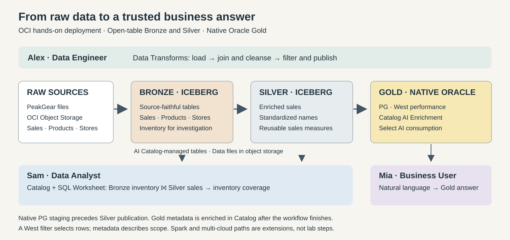
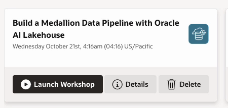
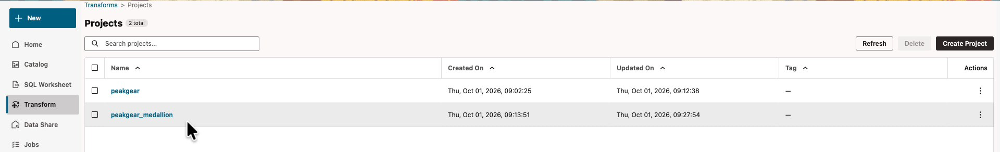

# Lab 1: Meet PeakGear and prepare your Lakehouse

## Introduction

**PeakGear** has sales and inventory data, but each team needs a different answer from it:

- **Alex** prepares reusable sales data.
- **Sam** compares recent sales with inventory.
- **Mia** wants to know which products lead in the West.

You will follow their work in **Oracle Autonomous AI Lakehouse**, from source data in **Bronze** to reusable sales in **Silver** and a focused product in **Gold**.

This first lab introduces the team and architecture, then helps you sign in and find the prepared Data Studio project. By the end, you will know where later tasks happen and how the three tiers fit together:

- **Bronze** keeps source data.
- **Silver** makes it reusable.
- **Gold** presents a purpose-built product.

Each tier gives the next team a useful starting point without repeating earlier preparation.

**Estimated Workshop Time:** 90 minutes, including a five-minute troubleshooting buffer.

**Estimated Lab Time:** 22 minutes.

### Objectives

* Explain the three personas and the purpose of each tier.
* Sign in to the reserved environment and connect Data Studio as `PG`.
* Locate the catalog, SQL Worksheet, and prepared Data Transforms project.

### Prerequisites

* An active LiveLabs reservation with database and OCI login details.
* The Data Studio URL supplied by the facilitator.
* A pre-provisioned environment with Bronze data, a mounted catalog, and the imported project.
* Basic SQL familiarity. No Spark programming experience is required.

## Task 1: Follow the three-persona journey

1. Meet the team and consider each role in the story. You will use your assigned account throughout; separate persona logins are not required.
  <details>
    <summary><strong>Expand to see the three roles</strong></summary>

      > - **Alex, Data Engineer:** prepares reusable sales data with Data Transforms workflows across the tiers.
      > - **Sam, Data Analyst:** compares recent sales with available inventory through catalog discovery and SQL across Bronze and Silver.
      > - **Mia, Business User:** finds the best-selling West-region products with natural-language queries against native Gold.
  </details>

2. Review the architecture diagram to see how the three tiers support the story.

    
  <details>
    <summary><strong>Expand for architecture details</strong></summary>

      > - Bronze and Silver are **Apache Iceberg tables**. OCI Object Storage holds their data files, and Oracle AI Data Catalog holds their metadata.
      > - Gold is native Oracle data in the `PG` schema of Autonomous AI Lakehouse. This workshop publishes one Gold table. Native intermediate tables support transformations; they are not the published Silver Iceberg table.
      > - The pattern can extend to other compatible clouds and engines. This exercise uses OCI and Oracle SQL.
  </details>

3. Note the objects used in the workshop. Quoted table names are case-sensitive.
  <details>
    <summary><strong>Expand to see workshop objects</strong></summary>

      > - **Bronze, mounted through `PG_AICAT`:** `"bronze"."products"`, `"bronze"."store_sales_transactions"`, `"bronze"."store_locations"`, and `"bronze"."store_inventory"`.
      > - **Native intermediate tables:** `PG."ailh_enriched_sales_stage"` and `PG."ailh_enriched_sales"`.
      > - **Published Silver, through `PG_AICAT`:** `"silver"."AILH_ENRICHED_SALES"`.
      > - **Native Gold:** `PG."ailh_gold_west_product_performance"`.
  </details>

4. Listen to the facilitator explain how open tables support this workshop.

    ```text
    Facilitator: “Open tables let compatible engines share data. Today we use Oracle SQL and visual Data Transforms, not a separate Spark cluster. AI Lakehouse can support selected tiers or the entire medallion pattern. This workshop runs on OCI; a second cloud is an architectural extension, not an exercise.”
    ```

## Task 2: Open your reservation and sign in

1. In LiveLabs, open **My Reservations**, select your reservation, and click **Launch Workshop**.

    

2. Open **View Login Info** for your reservation.
  <details>
    <summary><strong>Expand for credential handling</strong></summary>

      > - Keep the OCI username, initial password, tenancy, assigned compartment, database region, and `PG` database password private.
      > - Use the values from your reservation. They differ from the values shown in screenshots.
  </details>

3. Open the OCI console using **Launch OCI** or the supplied console link.
  <details>
    <summary><strong>Expand for OCI sign-in guidance</strong></summary>

      > - Sign in with the identity domain and username from your reservation.
      > - If prompted, change the initial password and store the new password securely.
  </details>

4. Use the database region listed in your reservation. It may differ from the initial OCI sign-in URL, so follow the reservation rather than a screenshot.

5. Open [Data Studio](https://datastudio.oracle.com) and choose **Sign in with your cloud account**. Use your assigned OCI account and password. If you are already signed in to OCI in the same browser, your session may carry over.

6. Click **Connect to database**. Select the assigned database region and compartment, choose your database, and connect as `PG`.
  <details>
    <summary><strong>Expand for database connection guidance</strong></summary>

      > - Use the `PG` database password from your reservation. It is separate from the OCI account password.
      > - Do not paste either password into worksheets, screenshots, or shared notes.
  </details>

## Task 3: Explore Data Studio and check the project

1. Locate **Catalog**, **SQL Worksheet**, **Transform**, and **Jobs** in the left navigation.

2. Open **Catalog** → **Locally Mounted Catalogs** → `PG_AICAT` → **bronze** → **Tables** and select `products`.
  <details>
    <summary><strong>Expand for sample data notes</strong></summary>

      > - Open **Sample Data** and allow a few seconds for rows to load.
      > - Bronze is already loaded. Silver may not appear until Lab 2, and you do not need to create it manually.
  </details>

3. Open **Transform** → **Projects** → `peakgear_medallion`. Do not use the separate `peakgear` project.

    

4. Confirm that the prepared project contains the three workflows.
  <details>
    <summary><strong>Expand to see workflows</strong></summary>

      > - `wf_01_raw_to_bronze`
      > - `wf_02_bronze_to_silver`
      > - `wf_03_silver_to_gold`
  </details>

5. Confirm the prepared project setup before continuing.
  <details>
    <summary><strong>Expand for project setup checks</strong></summary>

      > - The project, connections, catalog mount, and execution variables should already be in place.
      > - Do not import another ZIP, replace credentials, or edit connection endpoints. Ask the facilitator if the project is missing.
  </details>

    **Checkpoint:** Data Studio is connected as `PG`, Bronze is visible, and `peakgear_medallion` contains the workflows.

## Learn More

* [Oracle Autonomous AI Lakehouse](https://www.oracle.com/autonomous-database/autonomous-ai-lakehouse/)

You may now **proceed to the next lab**.

## Acknowledgements

* **Authors** - Ashish Jain, Sofia Arceo
* **Contributors** - Teodor C. Nechita
* **Last Updated By/Date** - Teodor C. Nechita, November 2026
