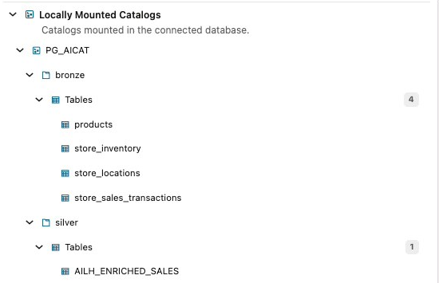
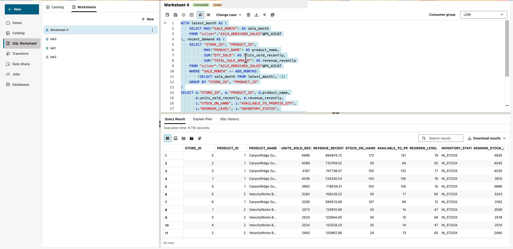

# Lab 3: Investigate inventory coverage across tiers

## Introduction

**Sam** needs to find store and product pairs where recent sales exceed the inventory available for new commitments.

In this lab, you will check the join grain and ATP values, then query Silver sales alongside Bronze inventory. You will get a review list for replenishment, without building another pipeline or copying inventory into Silver. Available to promise (ATP) is the quantity available for new commitments.

**Estimated Time:** 12 minutes.

### Objectives

* Discover the inventory asset needed for a business question.
* Check join grain before combining Bronze and Silver.
* Use SQL to identify candidates for replenishment review.

### Prerequisites

* Complete **Lab 2**.
* Silver must contain queryable enriched sales.
* Bronze must contain the assigned inventory extract.

## Task 1: Find the inventory asset

1. Inspect the Bronze inventory fields.
  <details>
    <summary><strong>Expand to locate Bronze inventory</strong></summary>

      > - Open **Data** → **Database** → **Locally Mounted Catalogs** → `PG_AICAT` → **bronze** → **Tables** and select `store_inventory`.
      > - Check its columns and sample rows, especially `STORE_ID`, `PRODUCT_ID`, and `AVAILABLE_TO_PROMISE_QTY`.
  </details>

2. Confirm the curated Silver sales table is available.
  <details>
    <summary><strong>Expand to locate Silver sales</strong></summary>

      > - Expand **silver** → **Tables** → `AILH_ENRICHED_SALES`.
      > - Alex published this curated sales table. Inventory remains in Bronze, but you can query it with Silver without creating another pipeline.
  </details>

    

3. Open **SQL Worksheet** and create **Lab 3 - Data checks**, or rename a blank worksheet. Run a catalog query to confirm both objects are available.

    ```sql
    <copy>
    SELECT owner, table_name
    FROM all_tables@PG_AICAT
    WHERE UPPER(table_name) LIKE '%INVENTORY%'
       OR UPPER(table_name) LIKE '%ENRICHED_SALES%'
    ORDER BY owner, table_name;
    </copy>
    ```

4. Confirm the results include `bronze.store_inventory` and `silver.AILH_ENRICHED_SALES`. Keep the quoted case in the SQL that follows.

    ```text
    Facilitator: “Discovery lets Sam find another governed asset and query it with Silver. This exercise joins across tiers in place. It does not silently promote raw inventory into a curated Silver product.”
    ```

## Task 2: Check the join grain

1. Check that inventory has no more than one row per store and product.

    ```sql
    <copy>
    SELECT "STORE_ID", "PRODUCT_ID", COUNT(*) AS row_count
    FROM "bronze"."store_inventory"@PG_AICAT
    GROUP BY "STORE_ID", "PRODUCT_ID"
    HAVING COUNT(*) > 1
    FETCH FIRST 20 ROWS ONLY;
    </copy>
    ```

  <details>
    <summary><strong>Expand for duplicate-key guidance</strong></summary>

      > - Expected result: no rows.
      > - If rows appear, stop and ask the facilitator to confirm the inventory snapshot or complete join key.
      > - Do not remove duplicates arbitrarily or sum repeated inventory snapshots.
  </details>

2. Check which sales months are available.

    ```sql
    <copy>
    SELECT MIN("SALE_MONTH") AS first_month, MAX("SALE_MONTH") AS latest_month
    FROM "silver"."AILH_ENRICHED_SALES"@PG_AICAT;
    </copy>
    ```

  <details>
    <summary><strong>Expand for sample month context</strong></summary>

      > - The reviewed sample contains only January 2025, so the first and latest months can match.
      > - The analysis uses the latest month and the preceding month when available; it does not require two months of data.
  </details>

3. Check the inventory row count and look for missing ATP values.

    ```sql
    <copy>
    SELECT COUNT(*) AS inventory_rows,
           SUM(CASE WHEN "AVAILABLE_TO_PROMISE_QTY" IS NULL THEN 1 ELSE 0 END)
               AS missing_atp_rows
    FROM "bronze"."store_inventory"@PG_AICAT;
    </copy>
    ```

  <details>
    <summary><strong>Expand for ATP data notes</strong></summary>

      > - The reviewed inventory sample has 1,200 rows and no missing ATP values. Another approved extract may have a different row count.
      > - Missing ATP means unknown, not zero, and the analysis excludes those rows.
      > - Together with the grain and month checks, this shows whether the join can duplicate sales, which period is covered, and whether inventory is known.
  </details>

## Task 3: Answer the inventory question

1. Save the data-check worksheet, open another worksheet, and run the query below. It aggregates sales at store/product grain before joining inventory, which prevents transaction-level sales from being multiplied.

    ```sql
    <copy>
    WITH latest_month AS (
        SELECT MAX("SALE_MONTH") AS sale_month
        FROM "silver"."AILH_ENRICHED_SALES"@PG_AICAT
    ), recent_demand AS (
        SELECT "STORE_ID", "PRODUCT_ID",
               MAX("PRODUCT_NAME") AS product_name,
               SUM("QTY_SOLD") AS units_sold_recently,
               SUM("TOTAL_SALE_AMOUNT") AS revenue_recently
        FROM "silver"."AILH_ENRICHED_SALES"@PG_AICAT
        WHERE "SALE_MONTH" >= ADD_MONTHS(
            (SELECT sale_month FROM latest_month), -1)
        GROUP BY "STORE_ID", "PRODUCT_ID"
    )
    SELECT d."STORE_ID", d."PRODUCT_ID", d.product_name,
           d.units_sold_recently, d.revenue_recently,
           i."STOCK_ON_HAND", i."AVAILABLE_TO_PROMISE_QTY",
           i."REORDER_LEVEL", i."INVENTORY_STATUS",
           d.units_sold_recently - i."AVAILABLE_TO_PROMISE_QTY"
               AS demand_stock_gap
    FROM recent_demand d
    JOIN "bronze"."store_inventory"@PG_AICAT i
      ON i."STORE_ID" = d."STORE_ID"
     AND i."PRODUCT_ID" = d."PRODUCT_ID"
    WHERE i."AVAILABLE_TO_PROMISE_QTY" IS NOT NULL
      AND d.units_sold_recently > i."AVAILABLE_TO_PROMISE_QTY"
    ORDER BY demand_stock_gap DESC, d.revenue_recently DESC
    FETCH FIRST 20 ROWS ONLY;
    </copy>
    ```

2. Review the store, product, recent units sold, available-to-promise quantity, and `DEMAND_STOCK_GAP`. A positive gap means recent sales exceed available inventory. In the recorded sample, store 5/product 1 has 4,986 recent units sold and ATP of 151, for a gap of 4,835; your result depends on the provisioned extract.

    

3. Use the results as a list for inventory review, not as an automatic reorder recommendation.
  <details>
    <summary><strong>Expand to interpret the results</strong></summary>

      > - Past sales are a demand proxy, not a forecast or an unfulfilled-order count.
      > - The inner join excludes sales keys with no matching inventory, and the query excludes rows with null ATP.
      > - No rows means no matched records satisfy this rule.
  </details>

4. Save the worksheet as **Inventory gap analysis**.
  <details>
    <summary><strong>Expand for saving and the checkpoint</strong></summary>

      > - Use **Save As** to name the worksheet.
      > - **Checkpoint:** you answered a business question using both tiers without publishing another physical table.
  </details>

## Learn More

* [Query mounted catalogs](https://docs.oracle.com/en-us/iaas/autonomous-database-serverless/doc/manage-catalogs.html)

You may now **proceed to the next lab**.

## Acknowledgements

* **Authors** - Ashish Jain, Sofia Arceo
* **Contributors** - Teodor C. Nechita
* **Last Updated By/Date** - Teodor C. Nechita, November 2026
