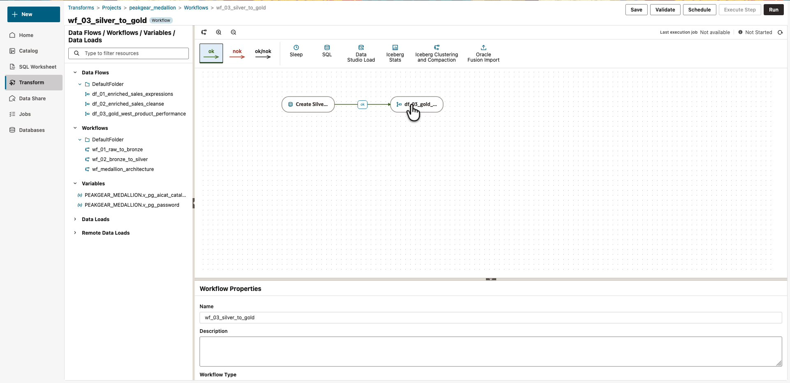
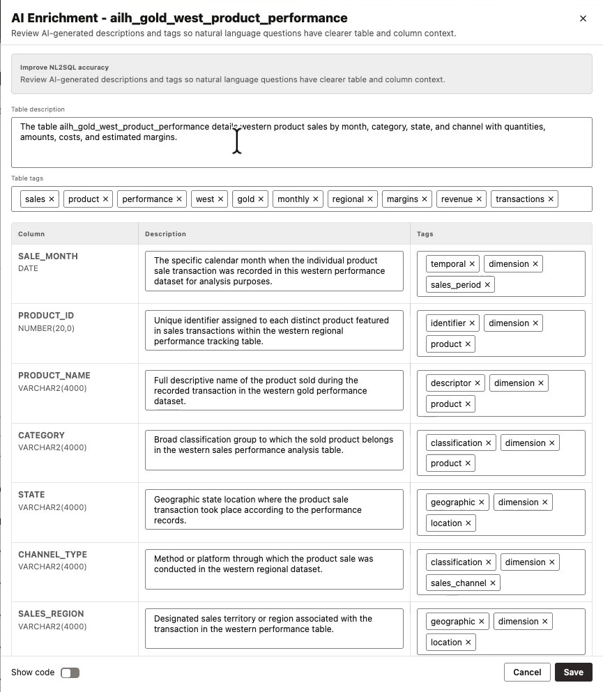
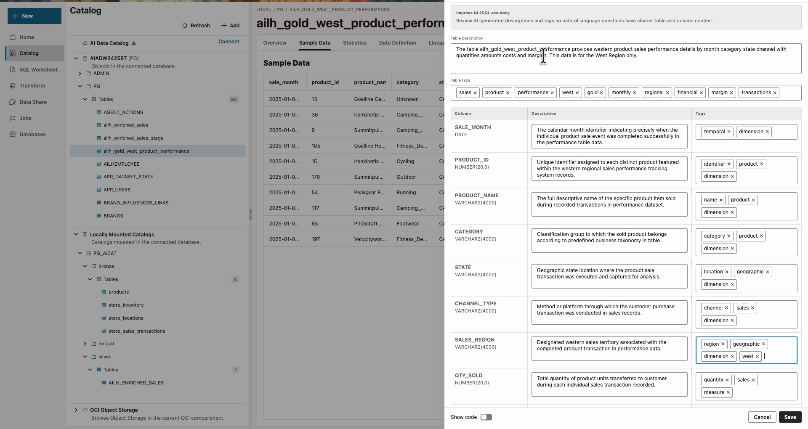
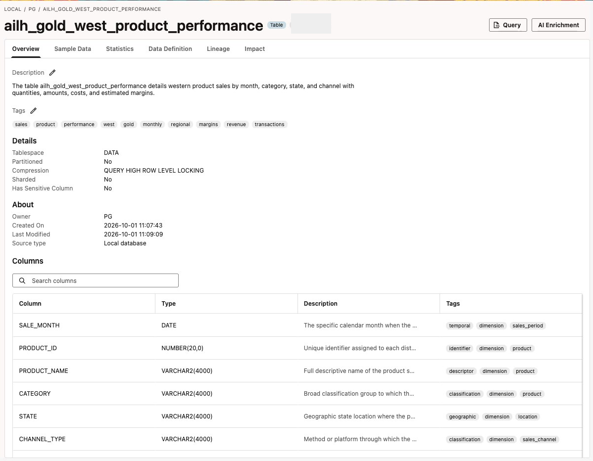

# Lab 4: Publish an AI-ready West-region Gold product

## Introduction

Alex publishes a business-focused Gold table in the native Oracle `PG` schema. After loading it, you use Catalog AI Enrichment to describe its West-region scope and columns.

The data-flow filter selects the rows. Metadata explains those rows to people and configured AI consumers; it does not filter data or enforce access controls.

Estimated Time: 12 minutes.

### Objectives

* Run the prepared Silver-to-Gold workflow.
* Browse and query the native Gold table.
* Review and refine AI-generated table and column metadata.

### Prerequisites

Complete Lab 2 successfully before this lab. The Silver workflow and final Iceberg load must be finished. Use `peakgear_medallion` in your assigned environment.

## Task 1: Run the Gold workflow

1. Open **Transform** → **Projects** → `peakgear_medallion` → **Workflows** → `wf_03_silver_to_gold`.

2. Review its two prepared steps: the Silver-view registration step and `df_03_gold_west_product_performance`.

    

    The Gold flow uses the `ailh_enriched_sales_v` bridge view. The view provides a local SQL reference to the curated source used by the prepared flow. The facilitator verifies its definition points to the published Silver catalog table before the event.

3. Click **Run** once. Retain the pre-provisioned variable defaults if prompted, then click **OK**. Do not run the master workflow or change the Gold flow.

4. Open **Jobs → Transforms** and select the new `wf_03_silver_to_gold` run. Click **Refresh** until both steps and the workflow finish successfully.

    **Checkpoint:** Gold execution has completed. Do not query an incomplete target or start this workflow before Silver finishes.

## Task 2: Inspect the native Gold table

1. Open **Data** → **Database**. Expand **your connected database** → **PG** → **Tables** → `ailh_gold_west_product_performance`. This is the native database branch, not **Locally Mounted Catalogs** → `PG_AICAT`.

2. Open **Sample Data** and inspect the sales month, product, sales amount, and `SALES_REGION`. Open **Statistics** to inspect available profiling information, then return to **Overview** to inspect columns and descriptions.

## Task 3: Enrich Gold metadata

1. In **Data** → **Database** → **your connected database** → **PG** → **Tables** → `ailh_gold_west_product_performance`, click **AI Enrichment** at the upper right. Wait for generation to finish.

2. Review the generated table description, column descriptions, and tags. They may need editing for accuracy and usefulness.

    

3. Add this sentence to the table description: **This data is for the West Region only.** Keep the useful generated description around it. The filter in the Gold data flow selects the West rows; the description explains that scope.

    

4. Review the descriptions for `SALE_MONTH`, `PRODUCT_NAME`, `TOTAL_SALE_AMOUNT`, and `SALES_REGION`. In the `SALES_REGION` row, add the tag `west`. Remove or correct any unsupported description.

5. Click **Save** at the bottom of the enrichment panel. Return to **Overview** and verify that the saved description and tags are visible.

    

6. Explain the distinction: the data-flow filter determines which rows Gold contains. Catalog metadata improves human discovery and gives configured AI analysis a clearer description; it does not enforce row security or guarantee that generated SQL will use the correct table.

    The AI connection is pre-configured. Do not enter model credentials.

## Task 4: Validate Gold with SQL

1. Open a new SQL worksheet, name it **Lab 4 - Gold checks**, and run:

    ```sql
    <copy>
    SELECT *
    FROM "PG"."ailh_gold_west_product_performance"
    FETCH FIRST 10 ROWS ONLY;
    </copy>
    ```

2. Run the region check separately.

    ```sql
    <copy>
    SELECT SALES_REGION, COUNT(*) AS gold_rows
    FROM "PG"."ailh_gold_west_product_performance"
    GROUP BY SALES_REGION;
    </copy>
    ```

    Expected: one row for `West` with a positive count. This confirms that the published product contains only West-region data. The reviewed sample has 199 Gold rows; the count can vary with the extract. Another region or a null value needs facilitator investigation.

3. Save the worksheet.

    **Checkpoint:** Gold is queryable, the region check returns only West, and the catalog metadata explains that scope.

## Learn More

* [Select AI concepts and metadata context](https://docs.oracle.com/en-us/iaas/autonomous-database-serverless/doc/select-ai-concepts.html)

You may now **proceed to the next lab**.

## Acknowledgements

* **Author** - Oracle AI Lakehouse workshop team
* **Last Updated By/Date** - Oracle AI Lakehouse workshop team, October 2026
