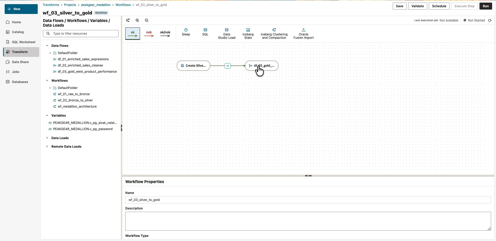
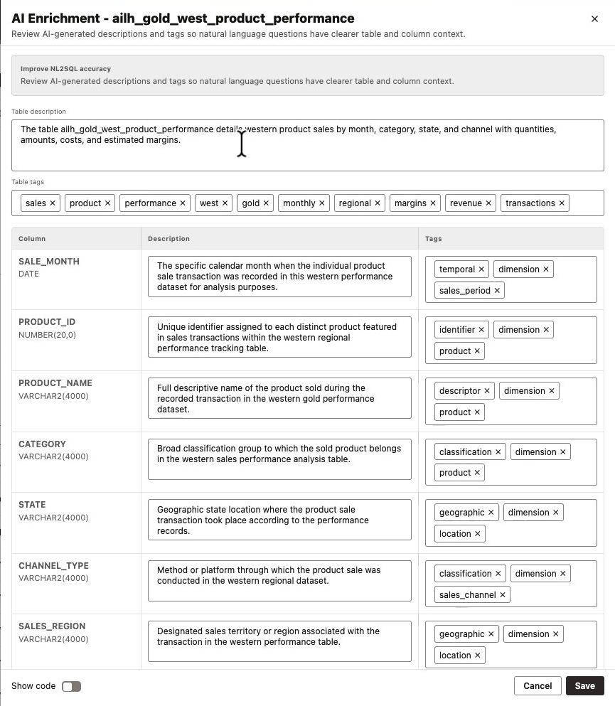
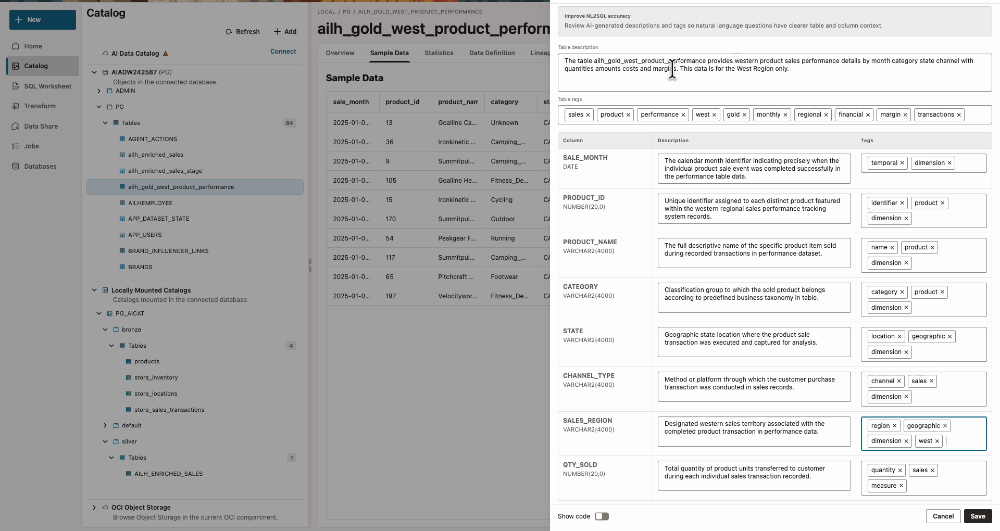
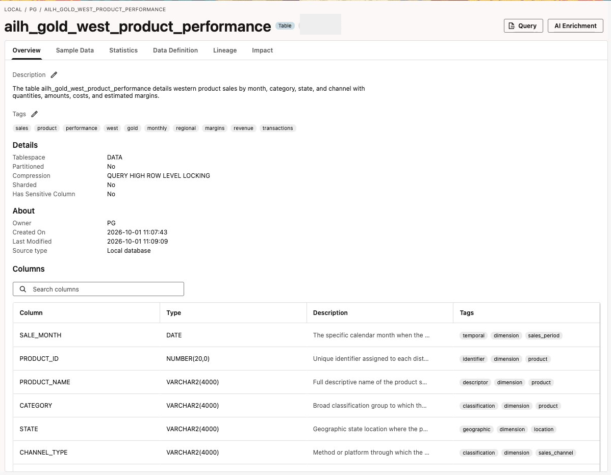

# Lab 4: Publish an AI-ready West-region Gold product

## Introduction

**Alex** has prepared reusable Silver sales data and is ready to publish a focused Gold product for the West region.

In this lab, you will run the prepared workflow, inspect the native Oracle table, and add descriptions and tags so people and configured AI consumers can understand its scope.

The workflow filter controls which rows enter Gold. Catalog metadata describes those rows; it does not filter data or enforce access controls.

**Estimated Time:** 12 minutes.

### Objectives

* Run the prepared Silver-to-Gold workflow.
* Browse and query the native Gold table.
* Review and refine AI-generated table and column metadata.

### Prerequisites

* Complete **Lab 2** successfully before this lab.
* The Silver workflow and final Iceberg load must be finished. Use `peakgear_medallion` in your assigned environment.

## Task 1: Run the Gold workflow

1. Go to **Transform** → **Projects** → `peakgear_medallion` → **Workflows** and select `wf_03_silver_to_gold`.

2. Review the Silver-view registration step and `df_03_gold_west_product_performance`.

    

  <details>
    <summary><strong>Expand to review the Silver source</strong></summary>

      > - The Gold flow reads through the `ailh_enriched_sales_v` bridge view.
      > - The facilitator must confirm that this view points to the published Silver catalog table before the event.
  </details>

3. Run the workflow once.
  <details>
    <summary><strong>Expand for workflow run settings</strong></summary>

      > - If prompted, keep the pre-provisioned variable defaults and click **OK**.
      > - Do not run the master workflow or change the Gold flow.
  </details>

4. In **Jobs** → **Transforms**, select the new `wf_03_silver_to_gold` run and click **Refresh** until both steps and the workflow finish successfully.

    **Checkpoint:** Gold execution has completed. Do not query an incomplete target or start this workflow before Silver finishes.

## Task 2: Inspect the native Gold table

1. Open the native Gold table `ailh_gold_west_product_performance`.
  <details>
    <summary><strong>Expand to find the native Gold table</strong></summary>

      > - In **Data** → **Database**, expand **your connected database** → **PG** → **Tables** and select the table.
      > - Use this native database branch, not **Locally Mounted Catalogs** → `PG_AICAT`.
  </details>

2. Inspect the table in three places.
  <details>
    <summary><strong>Expand to inspect the table</strong></summary>

      > - Open **Sample Data** and check the sales month, product, sales amount, and `SALES_REGION`.
      > - Open **Statistics** to review available profiling information.
      > - Return to **Overview** to inspect columns and descriptions.
  </details>

## Task 3: Enrich Gold metadata

1. Open **AI Enrichment** for the Gold table and wait for generation to finish.
  <details>
    <summary><strong>Expand to open AI Enrichment</strong></summary>

      > - Go to **Data** → **Database** → **your connected database** → **PG** → **Tables** → `ailh_gold_west_product_performance`.
      > - Click **AI Enrichment** at the upper right.
  </details>

2. Review the generated table and column descriptions and tags. Correct anything inaccurate or unsupported.

    

3. Add **This data is for the West Region only.** to the table description.
  <details>
    <summary><strong>Expand for the West-only description</strong></summary>

      > - Keep useful generated text around the sentence.
      > - The Gold data-flow filter selects the West rows; the description explains that scope.
  </details>

    

4. Review the key column descriptions and tag `SALES_REGION` as `west`.
  <details>
    <summary><strong>Expand for column metadata checks</strong></summary>

      > - Review `SALE_MONTH`, `PRODUCT_NAME`, `TOTAL_SALE_AMOUNT`, and `SALES_REGION`.
      > - Remove or correct unsupported descriptions.
  </details>

5. Save the enrichment and confirm the changes on **Overview**.
  <details>
    <summary><strong>Expand to save and verify changes</strong></summary>

      > - Click **Save** at the bottom of the enrichment panel.
      > - Return to **Overview** and check that the description and tags were saved.
  </details>

    

6. Confirm the filter and metadata serve different purposes.
  <details>
    <summary><strong>Expand to distinguish filters from metadata</strong></summary>

      > - The data-flow filter determines which rows Gold contains.
      > - Catalog metadata helps people find and understand the table, but it does not enforce row security or guarantee that generated SQL will use the correct table.
      > - The AI connection is pre-configured. Do not enter model credentials.
  </details>

## Task 4: Validate Gold with SQL

1. Open a new SQL worksheet named **Lab 4 - Gold checks** and run this query to inspect the published table:

    ```sql
    <copy>
    SELECT *
    FROM "PG"."ailh_gold_west_product_performance"
    FETCH FIRST 10 ROWS ONLY;
    </copy>
    ```

2. Run this region check separately.

    ```sql
    <copy>
    SELECT SALES_REGION, COUNT(*) AS gold_rows
    FROM "PG"."ailh_gold_west_product_performance"
    GROUP BY SALES_REGION;
    </copy>
    ```

    **Expected result:** one row for `West` with a positive count. The published product should contain only West-region data.
  <details>
    <summary><strong>Expand for sample count and follow-up</strong></summary>

      > - The reviewed sample has 199 Gold rows, but the count can vary with the extract.
      > - Ask the facilitator to investigate any other region or a null value.
  </details>

3. Save the worksheet.

    **Checkpoint:** Gold is queryable, the region check returns only West, and the catalog metadata explains that scope.

## Learn More

* [Select AI concepts and metadata context](https://docs.oracle.com/en-us/iaas/autonomous-database-serverless/doc/select-ai-concepts.html)

You may now **proceed to the next lab**.

## Acknowledgements

* **Authors** - Ashish Jain, Sofia Arceo
* **Contributors** - Teodor C. Nechita
* **Last Updated By/Date** - Teodor C. Nechita, November 2026
