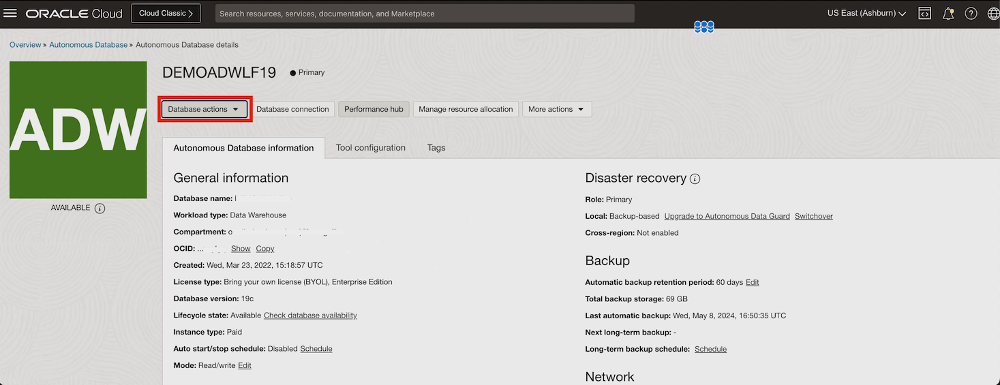
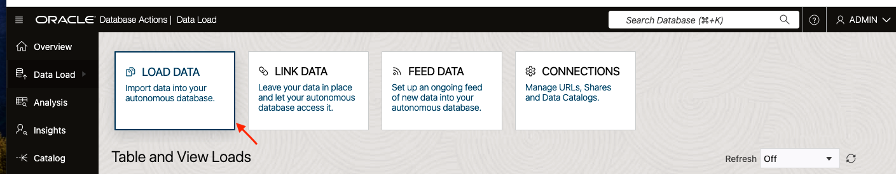
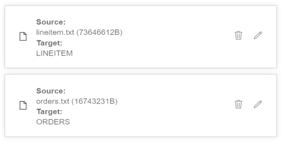

# Load data from object storage using Database Actions and scripting

## Introduction

This lab takes you through the steps needed to load and link sample data on [Oracle Cloud Infrastructure Object Storage](https://www.oracle.com/cloud/storage/object-storage.html) into an Oracle Autonomous Database instance in preparation for creating the sample integration mappings.

You can load data into your Autonomous Database (either Oracle Autonomous Data Warehouse or Oracle Autonomous Transaction Processing) using the built-in tools as in this lab, or you can use other Oracle and third-party data integration tools. With the built-in tools, you can load data:

+ from files in your local device,
+ from tables in remote databases, or
+ from files stored in cloud-based object storage (Oracle Cloud Infrastructure Object Storage, Amazon S3, Microsoft Azure Blob Storage, Google Cloud Storage).

You can also leave data in place in cloud object storage, and link to it from your Autonomous Database.

> **Note:** While this lab uses Oracle Autonomous Data Warehouse, the steps are identical for loading data into an Oracle Autonomous Transaction Processing database.

Estimated Time: 10 minutes

### About product

In this lab, we will learn more about the autonomous database's built-in Data Load tool - see the [documentation](https://docs.oracle.com/en/cloud/paas/autonomous-database/adbsa/data-load.html#GUID-E810061A-42B3-485F-92B8-3B872D790D85) for more information.

### Objectives

+ Access sample files in Object Storage using pre-authenticated request (PAR) URLs
+ Learn how to load data from object storage using Data Tools

### Prerequisites

+ This lab requires you to have access to an autonomous database instance; either Oracle Autonomous Data Warehouse (ADW) or Oracle Autonomous Transaction Processing (ATP).

## Task 1: Open the Data Load tool

The sample files are in the `informatica/` folder of the `livelabsfiles` bucket. The pre-authenticated request (PAR) URLs below provide file access without a separate Object Storage credential. Use the file URLs directly; bucket listing is not required.

1. On the database details page, click **Database Actions**.

    

2. Database Actions opens with you logged in as the Admin user.

3. On the Database Actions Launchpad page, under **Data Studio**, click **DATA LOAD**.

    

4. Choose **Load Data**, then **Cloud Store**. Continue to **Load Cloud Object**. Do not create a Cloud Store Location for this lab.

## Task 2: Load data from files in Object Storage using Data Tools

Load the two files in separate jobs to create the `ORDERS` and `LINEITEM` tables.

1. Paste the following **orders.txt** URL into **Select Cloud Store Location or enter public URL**. Press Enter.

    ```
    <copy>
    https://objectstorage.us-ashburn-1.oraclecloud.com/p/4Au3jJ-t8Wtw3LWyYsDMqQk2FdlXDvXCb1MYRS0J6P4QS-GCrv2YNOolWdtFMLZq/n/c4u04/b/livelabsfiles/o/informatica/orders.txt
    </copy>
    ```

2. Drag the displayed **orders.txt** file into the cart in the right-hand pane.

3. Click the pencil icon for the load task. Confirm the target table is **ORDERS**. Review the columns and data types, then click **Close**.

4. Click the Play or **Start** button to run the load job. Confirm **Run** if prompted, and wait for the load card to show a green tick.

5. Return to **Data Load** and start another **Load Data** job using **Cloud Store**. Check that the cart is empty. If the completed **ORDERS** item remains, click its **Remove** icon. Remove only the cart item, not the database table. Paste the following **lineitem.txt** URL into **Select Cloud Store Location or enter public URL**. Press Enter.

    ```
    <copy>
    https://objectstorage.us-ashburn-1.oraclecloud.com/p/4Au3jJ-t8Wtw3LWyYsDMqQk2FdlXDvXCb1MYRS0J6P4QS-GCrv2YNOolWdtFMLZq/n/c4u04/b/livelabsfiles/o/informatica/lineitem.txt
    </copy>
    ```

6. Drag the displayed **lineitem.txt** file into the cart in the right-hand pane.

7. Click the pencil icon for the load task. Confirm the target table is **LINEITEM**. Review the columns and data types, then click **Close**.

    

8. Click the Play or **Start** button to run the second load job. Confirm **Run** if prompted, and wait for the load card to show a green tick.

9. Confirm that the **ORDERS** and **LINEITEM** load jobs both completed successfully before continuing to the next lab.

This completes the Data Load lab. We now have two tables loaded into the Autonomous Database from the Object Storage. We will be working with these tables in later labs.

## Acknowledgements

* **Author** - Larry Fumagalli, Outbound Product Management
* **Contributors** -  Marty Gubar, Autonomous Database Product Management
* **Last Updated By/Date** - Larry Fumagalli, Outbound Product Management, May 2024
